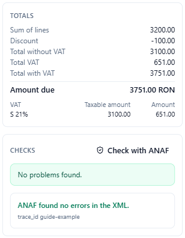
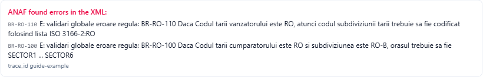

# Check an invoice with ANAF

Adika checks every invoice against the e-Factura rules it knows while you fill it in. ANAF runs its own, complete set of rules when you upload. **Check with ANAF** sends the XML to ANAF's public validation service first, so you see ANAF's answer before the invoice is official.

The check:

- needs an internet connection,
- does **not** need an SPV account, a certificate or a connection to SPV,
- does **not** register or send the invoice: ANAF only reads the XML and answers,
- sends the whole invoice XML to ANAF (this is why it only runs when you press the button).

## Check a new invoice

1. Fill in the invoice in **Convert → New e-invoice** until the **Checks** list shows no red errors (the button is disabled while Adika itself still finds errors).
2. Click **Check with ANAF** in the **Checks** box.
3. After a few seconds ANAF's answer appears under Adika's own checks.

- **ANAF found no errors in the XML.** The invoice passes ANAF's validation. You can create it and send it.
- **ANAF found errors in the XML:** followed by ANAF's messages. Each message starts with the rule ANAF applied, such as **BR-RO-110** or **BR-CO-15**. See [e-Factura problems](efactura-troubleshooting.md#anaf-error-messages) for what the common rules mean.
- The small **trace_id** line is ANAF's reference for this check. Keep it if you need to ask ANAF about a result.

If you change the invoice after the check, Adika says **The invoice changed after ANAF checked it.** Check again before you send it.

## Check an XML file you already have

You can check any e-Factura XML, for example one made by another program:

1. Click **Convert → ANAF e-Factura**.
2. On the **Send** tab click **Choose XML…** and choose the file.
3. Click **Check with ANAF**.

The answer appears under the buttons. Nothing is uploaded; the **Send to ANAF** button is separate.

## What the check covers

ANAF's validation service applies the same schema and business rules (EN 16931 and CIUS-RO) as the upload. An invoice that passes the check normally passes the upload too. The check does not look at your SPV account: whether you have the right to send invoices for the seller's CUI is only checked when you send.

For a credit note, Adika automatically uses ANAF's credit-note validation (FCN); for invoices, the invoice validation (FACT1).

## When the check does not work

- **"ANAF's firewall rejected the XML (it sometimes blocks valid invoices). Try again later."** ANAF's protection sometimes refuses requests. Wait a few minutes and try again.
- **"ANAF's validation answered HTTP 5xx"**, or no answer: ANAF's service is down or busy. Try later; Adika's own checks are still valid.
- **"The ANAF connection is turned off by your organisation."** Your IT department switched off online features. Ask them, or validate the XML another way.
- No internet: the button shows an error message from Windows. Adika's own checks keep working offline.

Next: [Send invoices to ANAF](efactura-anaf-send.md)
