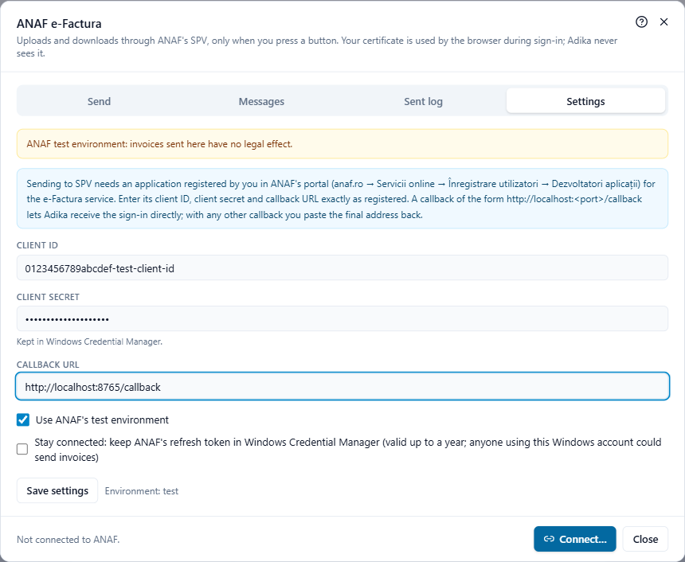
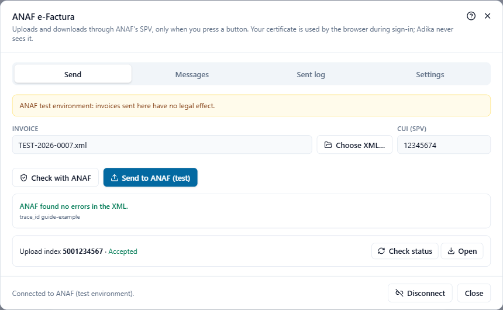
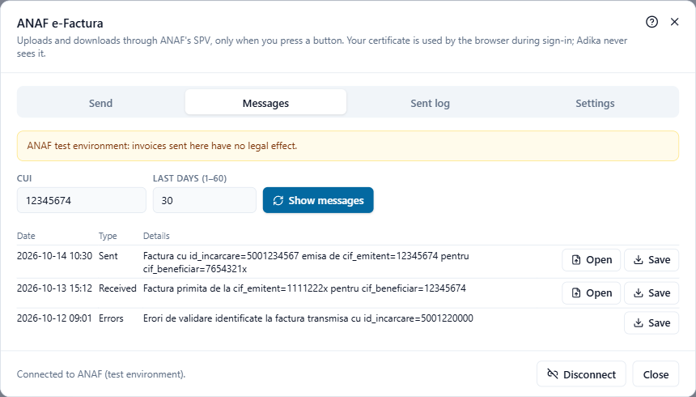
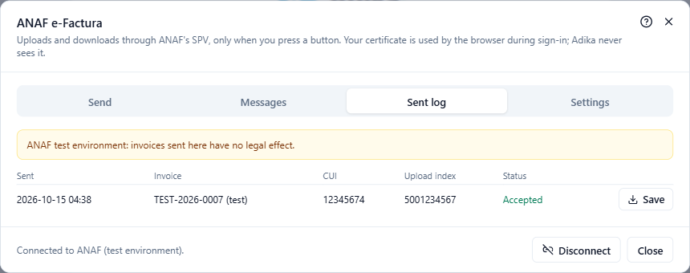

# Send invoices to ANAF (SPV)

The **ANAF e-Factura** window (**Convert → ANAF e-Factura**) uploads your invoices to ANAF's SPV, follows their status, and lists and downloads the invoices you sent and received. Adika talks to ANAF only when you press a button.

> **Please note.** Signing in to SPV and uploading have been tested against a simulated ANAF, not yet against ANAF's real servers. Try the **test environment** first (see Step 2) and check your first real uploads in SPV's web pages as well.

## What you need

1. **SPV access for the company's CUI.** The person who signs in must be registered in SPV for that CUI (legal representative or authorised person, *împuternicit*), with a qualified certificate on a token or smart card.
2. **An application registered at ANAF.** ANAF lets programs use SPV only through an application that *you* register. It gives you a **Client ID** and a **Client Secret**. This is done once.
3. The **token** with your certificate, plugged in when you connect.

Adika never sees your certificate or its PIN: you sign in on ANAF's own page in your web browser.

## Step 1: register the application at ANAF (once)

1. On **anaf.ro** go to **Servicii online → Înregistrare utilizatori → Dezvoltatori aplicații**.
2. Sign in with your qualified certificate.
3. Register an application (ANAF calls it the OAuth profile):
   - **Name**: anything you recognise, for example "Adika – TEST SRL".
   - **Callback URL**: `http://localhost:8765/callback`. You may use another port number (between 1024 and 65535) instead of 8765; what matters is that you type exactly the same address in Adika.
   - **Service**: tick **E-Factura**.
4. ANAF shows the **Client ID** and the **Client Secret**. Copy both somewhere safe.

ANAF's pages change from time to time; if the names above differ, look for the developers' (OAuth) registration.

## Step 2: enter the settings in Adika

Click **Convert → ANAF e-Factura** and open the **Settings** tab (it opens by itself the first time).

- **Client ID**, **Client secret** and **Callback URL**: exactly as registered at ANAF. The client secret is kept in Windows Credential Manager, not in a file.
- **Use ANAF's test environment**: ANAF's test SPV. Invoices sent there have no legal effect; a yellow bar reminds you. Untick it for real invoices.
- **Stay connected**: keeps ANAF's long-lived sign-in (refresh token) in Windows Credential Manager, so you do not have to sign in with the token every time. It is valid up to a year; anyone who uses your Windows account could then send invoices. Leave it off on shared computers.

Click **Save settings**.

## Step 3: connect

1. Plug in your token.
2. Click **Connect…** at the bottom of the window.
3. Your web browser opens ANAF's sign-in page. Choose your certificate and type the token's PIN when Windows asks.
4. The browser shows "Sign-in finished. You can close this window and return to Adika PDF Editor." The bottom of the ANAF window now says **Connected to ANAF.**

While Adika waits (up to 5 minutes) you can press **Cancel**.

If your callback URL is **not** `http://localhost:<port>/…` (for example an https address of your company), Adika cannot receive the answer by itself. After signing in, the browser ends on that page: copy the whole address from the browser's address bar, paste it into the box Adika shows and click **Continue**.

**Disconnect** ends the session and forgets the stored sign-in.

## Step 4: send an invoice

There are two ways to get an invoice into the **Send** tab:

- In **New e-invoice**, tick **Then send to ANAF…** before **Create e-invoice**; the window opens with the new invoice.
- Or click **Choose XML…** and choose an e-Factura XML file.

1. Check **CUI (SPV)**: it is taken from the invoice (the seller's CUI; for a self-billed invoice, the buyer's). It must be a CUI you have SPV rights for.
2. Optional: **Check with ANAF** (see [Check an invoice with ANAF](efactura-anaf-check.md)).
3. Click **Send to ANAF** (in the test environment: **Send to ANAF (test)**).

ANAF answers with an **Upload index** (index de încărcare): the number of your upload. Adika writes it in the sent log.

## Step 5: follow the status

ANAF processes the invoice in the following minutes. While the window is open, Adika asks every 30 seconds, for at most 10 minutes. **Check status** asks immediately.

| Status | Meaning |
| --- | --- |
| **Sent** / **Being processed** | ANAF received the file and is still checking it. |
| **Accepted** | ANAF accepted the invoice and sent it to the buyer. **Open** shows the invoice ANAF signed. |
| **Rejected (errors)** | ANAF found errors. **Save** keeps ANAF's answer (a ZIP with the error list); the errors are also listed in the window. The invoice is **not** sent: fix it and upload it again. |
| **Rejected at upload** | ANAF refused the file at once (for example not valid XML). |

You can close the window: the status can be checked later from the **Sent log** tab.

## Messages: invoices sent and received

The **Messages** tab lists what SPV holds for a CUI: invoices you sent, invoices you **received** from suppliers, error reports and buyer messages.

1. Enter the **CUI** and **Last days (1–60)**.
2. Click **Show messages**.
3. For each message, **Open** shows the invoice as a readable PDF (see [Read a received e-Factura](efactura-read.md)); **Save** keeps ANAF's ZIP file.

ANAF keeps the messages for 60 days only. Save the ZIP files of your invoices in your archive.

## The sent log

The **Sent log** tab lists every upload made from this computer: date, invoice number, CUI, upload index and the last known status. Uploads still in progress have **Check status**; finished ones have **Save** for ANAF's answer. Test uploads are marked "(test)".

## Problems

Sign-in errors, "access refused" messages and ANAF's rule errors are explained in [e-Factura problems](efactura-troubleshooting.md).
