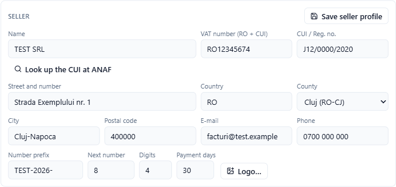
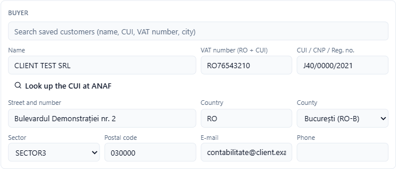
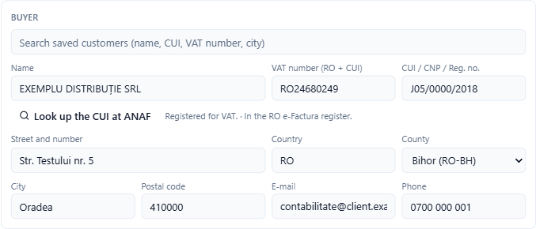
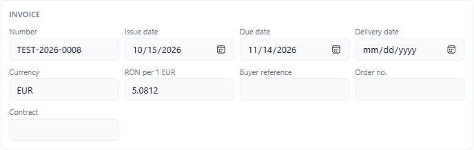
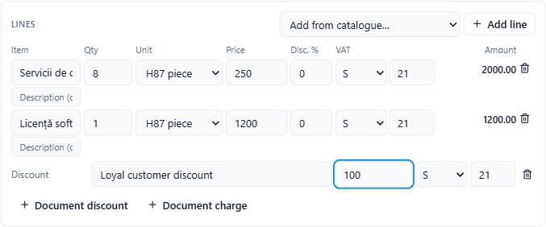
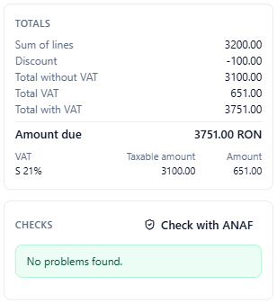
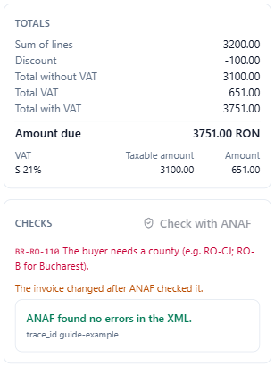

# Create an invoice

Adika issues e-Factura invoices (and Peppol and Factur-X invoices) from a form. It calculates the totals as you type, checks the invoice against the e-Factura rules and saves the files you choose: the XML for ANAF's SPV, a readable PDF with the XML inside, or a Factur-X PDF.

Everything is done on your computer. ANAF is contacted only if you press **Look up the CUI at ANAF**, **Check with ANAF** or send the invoice.

## Start a new invoice

Click **Convert → New e-invoice** (the start screen also has a **New e-invoice** link). The **New e-invoice** window opens.

At the top choose:

- **Seller profile**: your company (see below). The first time, choose **New seller…**.
- **Format**: **Romania: e-Factura (CIUS-RO)** for invoices to ANAF; **EU: Peppol BIS Billing 3.0 (UBL)** for Peppol customers; **Factur-X / ZUGFeRD (CII, EN 16931)** for customers in France or Germany who want a PDF with data inside.
- **Type**: **Invoice (380)** in most cases; **Credit note (381)**, **Corrected invoice (384)**, **Self-billed invoice (389)** and **Invoice information for accounting (751)** are also available.

## Your company: the seller profile

The first time, fill in your company in the **Seller** section and click **Save seller profile**. Adika keeps the details, the bank account and a numbering series, and fills them in on every later invoice. You can have several seller profiles (for example several companies you invoice for).

- **VAT number (RO + CUI)**: for a VAT payer, `RO` followed by the CUI. Leave it empty if the company is not registered for VAT and put the CUI in **CUI / Reg. no.**
- **County**: choose from the list (e-Factura needs the official code, such as RO-CJ). For Bucharest choose **București (RO-B)**; the city then becomes a **Sector** list (SECTOR1 to SECTOR6), as ANAF requires.
- Click **Edit** to change the profile later. Under the address you then also see:
  - **Number prefix**, **Next number** and **Digits**: the numbering series. With prefix `TEST-2026-`, next number 8 and 4 digits, the next invoice is `TEST-2026-0008`. After each invoice the number moves on by itself.
  - **Payment days**: the due date is set this many days after the issue date.
  - **Logo…**: a PNG or JPEG picture printed on the readable PDF.

## The buyer

Type a few letters in **Search saved customers (name, CUI, VAT number, city)** and click the customer. Every customer you invoiced, and every buyer of an invoice you issued and opened, is remembered.

For a new Romanian customer, type the CUI (in **VAT number** with RO, or in **CUI / CNP / Reg. no.**) and click **Look up the CUI at ANAF**. Adika asks ANAF's public VAT register and fills in the name, the registration number, the address with county and city, and the VAT number when the company is a VAT payer. Next to the button you see what ANAF says: registered for VAT or not, whether the company is in the RO e-Factura register, VAT on cash accounting, and warnings when the company is inactive or deregistered (radiată).

For a private person, put the CNP in **CUI / CNP / Reg. no.** (13 zeros when the person has no CNP).

## Invoice details

- **Number** comes from the numbering series; you can change it.
- **Issue date**, **Due date**, **Delivery date**.
- **Currency**: RON by default. For another currency, see [Invoices in another currency](efactura-vat-payment.md#invoices-in-another-currency).
- **Buyer reference**, **Order no.**, **Contract**: optional references the buyer asked for.

## Lines

Each line has:

- **Item** (the name; e-Factura allows 100 characters) and an optional description,
- **Qty**, **Unit** (international unit codes: H87 piece, HUR hour, KGM kilogram…),
- **Price**: the unit price **without VAT**,
- **Disc. %**: a discount on this line,
- **VAT**: the category and the rate (see [VAT, currency and payment](efactura-vat-payment.md)),
- **Amount**: the line total without VAT, calculated.

**Add line** adds an empty line. **Add from catalogue…** adds an item you sold before (tick **Add the items to the catalogue** at the bottom right to keep the items of this invoice). The bin removes a line.

**Document discount** and **Document charge** apply to the whole invoice. VAT categories other than the standard rate, exemption reasons, discounts and charges, and the payment details are explained in [VAT, currency and payment](efactura-vat-payment.md).

## Payment and notes

Fill in the **Payment means**, the **IBAN** (your saved accounts are offered), the **Payment terms** and any **Notes**. See [VAT, currency and payment](efactura-vat-payment.md#payment-and-notes) for every field.

## Totals and checks

The right side shows the totals while you type: sum of lines, discounts and charges, total without VAT, VAT per rate, total with VAT and **Amount due**.

Under **Checks** Adika lists every problem with the rule it comes from (for example **BR-RO-110**: the buyer needs a county). Red lines are errors: **Create e-invoice** stays disabled until they are fixed. Amber lines are warnings: you may issue the invoice, but read them. **No problems found.** means the invoice follows the rules Adika knows.

For a second opinion from ANAF itself, press **Check with ANAF**. See [Check an invoice with ANAF](efactura-anaf-check.md).

## Choose the files and create the invoice

At the bottom of the window, tick the files you want:

- **e-Factura XML (for ANAF SPV)**: the file you upload to SPV (or that Adika sends for you).
- **PDF with XML attached (PDF/A-3)**: a readable, archival PDF of the invoice with the XML inside. Good for e-mailing to the customer and for your archive.
- **Factur-X PDF**: a PDF with the invoice data in the European CII format.
- **Then send to ANAF…**: after the files are saved, the **ANAF e-Factura** window opens with this invoice ready to send. See [Send invoices to ANAF](efactura-anaf-send.md).

Click **Create e-invoice**. Adika asks where to save each file (the invoice number is the suggested name), opens the readable invoice and then:

- adds the buyer to your customers (or updates them),
- adds the items to the catalogue, if ticked,
- moves the numbering series to the next number.

Seller profiles, customers and the catalogue are stored only on this computer, in Adika's data folder.

## Peppol and Factur-X

- **Peppol**: two more fields appear for each party, **Electronic address (endpoint)** and **Scheme (EAS)**. Left empty, they are filled from the VAT number. Peppol also needs a **Buyer reference** or an **Order no.**
- **Factur-X**: the invoice is written in the CII format; choose **Factur-X PDF** as output. **Check with ANAF** is not offered for Peppol invoices.

Next: [Credit notes](efactura-credit-notes.md) · [Send invoices to ANAF](efactura-anaf-send.md)
