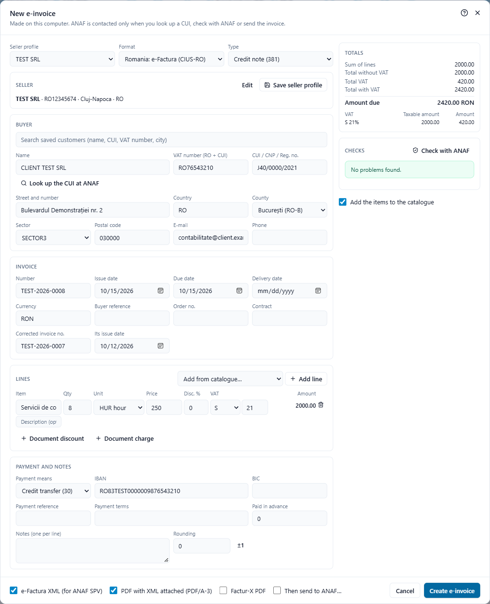

# Credit notes

A credit note cancels an invoice in full or in part: goods returned, a price reduced after the invoice, an invoice issued by mistake. In e-Factura there are two accepted ways to do it, and Adika supports both.

## The two ways

**1. Credit note (type 381).** A separate document of type "credit note". Its amounts are written as **positive** numbers: they are the amounts credited. It refers to the invoice it corrects (the e-Factura field BT-25, "preceding invoice reference"). Adika writes it as a UBL *CreditNote*, which is what ANAF expects for type 381.

**2. Storno invoice (type 380 with negative quantities).** An ordinary invoice whose lines have **negative quantities**, so the totals are negative. Many Romanian accounting programs work this way ("factură de stornare"). Here, too, you should name the invoice being reversed.

Both are valid in e-Factura. Ask your accountant which one your company uses and keep to it.

## Create a credit note for one of your invoices

1. Open the invoice you want to credit: the XML you issued, the ZIP downloaded from SPV, or the PDF with the XML inside (see [Read a received e-Factura](efactura-read.md)).
2. Click **Convert → E-invoice**.
3. Click **Create credit note**.

The **New e-invoice** window opens, already filled in:

- **Type** is **Credit note (381)**.
- **Corrected invoice no.** and **Its issue date** hold the number and date of the original invoice (BT-25 and BT-26).
- The seller, buyer and all the lines are copied from the invoice, with the same quantities and prices, so the credit note cancels it in full.
- **Number** is the next number of your seller profile's series (if the seller is one of your saved profiles).
- The due date is today; the payment terms and notes are cleared.

Now adjust it:

- **Partial credit**: change the quantities (for example 2 of the 10 pieces returned) or the prices (a discount after the fact), or remove the lines that are not credited.
- Add a note explaining the reason, for example "Retur marfă conform PV nr. 12".

Check the **Checks** list, choose the files at the bottom (usually **e-Factura XML (for ANAF SPV)** and **PDF with XML attached (PDF/A-3)**) and click **Create e-invoice**.

> Leave the quantities and prices **positive** in a credit note (type 381). A negative quantity in a credit note would credit a negative amount, that is, charge the customer again.

## Credit note without the original file

If you do not have the original invoice file:

1. Click **Convert → New e-invoice**.
2. Choose **Type → Credit note (381)**.
3. Fill in **Corrected invoice no.** and **Its issue date** of the invoice you credit. If you leave the number empty, the checks show a warning (BT-25: "Give the number of the invoice being corrected or credited.").
4. Add the credited lines with positive quantities and prices.

## Storno invoice

1. Click **Convert → New e-invoice** and keep **Type → Invoice (380)**.
2. Add the lines with a **negative quantity** (for example `-2`). The price stays positive; e-Factura does not allow negative prices (rule BR-27).
3. Name the reversed invoice: choose **Corrected invoice (384)** if your accountant wants that type, which shows the **Corrected invoice no.** field, or mention the invoice in **Notes**.

## Credit notes and ANAF

You send a credit note to SPV the same way as an invoice: see [Send invoices to ANAF](efactura-anaf-send.md). Adika recognises the credit note and uses ANAF's credit-note format for **Check with ANAF** and for the upload; you do not need to choose anything.

## Credit notes in other formats

- **Peppol**: the same: type 381, positive amounts, reference to the invoice.
- **Factur-X**: type 381 in CII. Factur-X has no separate credit-note document; the type code says it.

## Opening a received credit note

A credit note you receive opens like an invoice (**Open**, choose the XML or ZIP). The readable PDF is titled "Credit note", and the E-invoice dialog shows its data. **Create credit note** on a credit note (or on a storno invoice) makes a document that reverses it again, with the signs turned.
