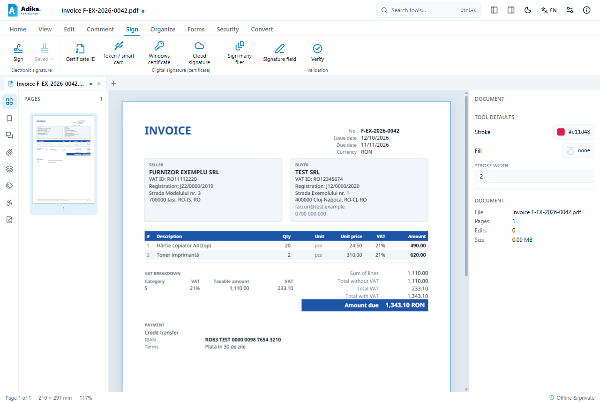
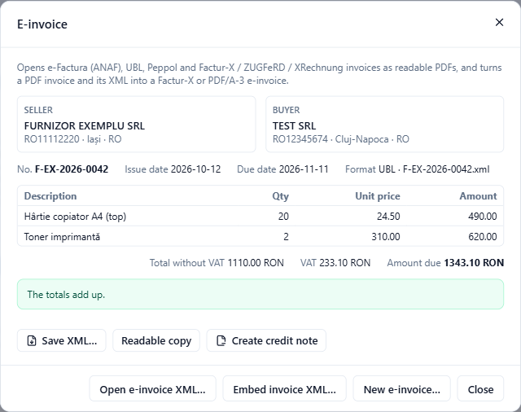

# Read a received e-Factura

An e-Factura is an XML file: a computer format that is hard to read on screen. Adika turns it into a normal, readable invoice in PDF and keeps the original XML attached inside that PDF.

Adika reads:

- **e-Factura** invoices and credit notes (UBL 2.1 with the Romanian rules CIUS-RO),
- the **ZIP files** you download from ANAF's SPV (the invoice XML plus ANAF's signature file),
- other European formats: **Peppol** (UBL), **XRechnung**, and **Factur-X / ZUGFeRD** (CII).

## Open the invoice

1. Click **Open** on the **Home** tab (or press **Ctrl+O**). In the file type list, the XML and ZIP files are included.
2. Choose the `.xml` file, or the `.zip` file exactly as you downloaded it from SPV. You do not need to unpack it.

You can also drag the file into the Adika window, or use **Convert → E-invoice → Open e-invoice XML…**.

The invoice opens in a new tab as a readable PDF:

The readable invoice shows the seller and the buyer, the invoice number and dates, every line, the VAT breakdown per rate, the totals and the payment details (IBAN, terms). Its labels are in the interface language: switch the language to Romanian before opening if you want a Romanian copy.

> The readable PDF is new and not yet saved: the tab shows the ● mark. Press **Save** to keep it, for example in your accounting folder. The original XML travels inside the PDF, so the saved PDF is a complete record.

## See the invoice data and the sum checks

With the readable invoice (or any PDF that carries an invoice, such as a Factur-X PDF) open, click **Convert → E-invoice**:

The dialog shows:

- **Seller** and **Buyer** with their VAT numbers, city and country,
- the number, the issue date, the due date and the format (UBL or CII) with the name of the XML file,
- the lines with quantities, unit prices and amounts,
- **Total without VAT**, **VAT** and **Amount due**.

Adika recalculates the invoice: each line (quantity × price), the sum of the lines, the VAT of each rate, the total with VAT and the amount due. When everything matches you see **The totals add up.** When something does not, a yellow box lists exactly what, for example "The lines add up to 1,110.00, the invoice says 1,100.00." The same list is printed in a **Checks** section at the end of the readable PDF.

A rounding difference of one ban (0.01) is tolerated. Bigger differences usually mean the issuer's program calculated wrongly: ask the supplier for a corrected invoice before you pay or record it.

> **ANAF's signature.** The ZIP from SPV contains a signature file from ANAF (`semnatura_….xml`). Adika shows the invoice but does not check that signature. If you need proof that the file came from SPV, keep the original ZIP as well.

## Buttons in the E-invoice dialog

- **Save XML…** saves the invoice XML as a separate file (for example to import it into your accounting program).
- **Readable copy** opens a new readable PDF of the invoice, in the current interface language.
- **Create credit note** starts a credit note for this invoice. See [Credit notes](efactura-credit-notes.md).
- **Open e-invoice XML…** opens another XML or ZIP file.
- **Embed invoice XML…** attaches an invoice XML to the PDF that is open (see below).
- **New e-invoice…** starts a new invoice. See [Create an invoice](efactura-create.md).

## Where is the XML in the PDF?

Open **View → Attachments** (or the paper clip in the left panel). The invoice XML is listed there; you can save it from that list too.

## Turn a PDF invoice and its XML into one file

If you have the PDF of an invoice and its XML separately (for example from another program), open the PDF and use **Convert → E-invoice → Embed invoice XML…**. Choose the XML file:

- a **CII** XML makes a **Factur-X / ZUGFeRD** invoice (the format used in France and Germany),
- a **UBL** XML (e-Factura, Peppol) makes a **PDF/A-3** archival file with the XML embedded.

Adika asks where to save the result (the suggested name ends in `-facturx` or `-einvoice`) and then opens it. The original PDF is not changed.

## Customers are remembered

When you open an invoice that **you** issued (the seller is one of your saved seller profiles), its buyer is added to your customer list for new invoices.

## If something goes wrong

- "This file is not an electronic invoice (UBL, e-Factura or CII)": the file is another kind of XML, or the ZIP holds no invoice (for example an error report from ANAF). See [e-Factura problems](efactura-troubleshooting.md).
- The invoice opens but shows problems: read them in the yellow box; they come from the supplier's file, not from Adika.
