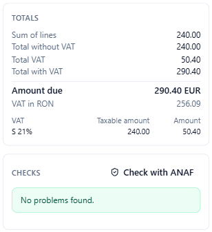

# VAT, currency and payment

This page explains the parts of the **New e-invoice** window that need some tax knowledge: VAT categories and exemption reasons, discounts and charges, invoices in a foreign currency, and the payment details. For the whole window, see [Create an invoice](efactura-create.md).

## VAT categories

Each line, and each document discount or charge, has a **VAT** category (the letters) and a rate (the number):

| Code | Meaning | When |
| --- | --- | --- |
| **S** | Standard rate | Normal sales with VAT; type the rate (for example 21 or 11) |
| **Z** | Zero rated | Goods taxed at 0 % |
| **E** | Exempt | Exempt operations; you must give the exemption reason |
| **AE** | Reverse charge (taxare inversă) | The buyer pays the VAT |
| **K** | Intra-community supply | Sales to a VAT-registered buyer in another EU country |
| **G** | Export outside the EU | Goods leaving the EU |
| **O** | Not subject to VAT | Sellers not registered for VAT |
| **L**, **M** | Canary Islands, Ceuta and Melilla | Rarely needed in Romania |

The rules Adika checks for you:

- **S** needs a rate above 0 and the seller's VAT number.
- **AE** needs the seller's VAT number and the buyer's VAT or registration number.
- **K** needs both VAT numbers and the **Delivery date**.
- **O** cannot be mixed with other categories, and the invoice then carries no VAT numbers.

The **Totals** box shows a row per category and rate: the taxable amount and the VAT.

## Exemption reasons

For **E**, **AE**, **K**, **G** and **O**, a row appears under the lines with two fields: **VATEX code** and **Exemption reason**. e-Factura requires at least one of them.

Adika fills in the usual values for e-Factura:

| Category | VATEX code | Reason written |
| --- | --- | --- |
| AE | VATEX-EU-AE | Taxare inversă |
| K | VATEX-EU-IC | Livrare intracomunitară scutită |
| G | VATEX-EU-G | Export scutit de TVA |
| O | VATEX-EU-O | Operațiune care nu intră în sfera de aplicare a TVA |

For **E** (exempt) write the reason yourself, usually the legal basis (for example the article of the Fiscal Code). Your accountant knows the right wording.

## Discounts and charges

- **Disc. %** on a line reduces that line by a percentage.
- **Document discount** reduces the whole invoice by an amount (for example a loyalty discount).
- **Document charge** adds an amount to the whole invoice (for example transport or packaging).

Each document discount or charge has a **Reason** and its own VAT category and rate, because the VAT must be calculated on it as well. A discount without a reason gets a general one and a warning (BR-33).

## Invoices in another currency

When the **Currency** is not RON (for example EUR), an e-Factura must also give the total VAT in RON. A field **RON per 1 EUR** appears next to the currency:

1. Type the currency code in **Currency** (three letters: EUR, USD…).
2. Type the exchange rate in **RON per 1 EUR**, usually the BNR rate your accountant uses.
3. The **Totals** box shows **VAT in RON** under the amount due.

Without the rate, the checks show **BR-RO-030** and the invoice cannot be created. The amounts of the lines stay in the invoice currency.

## Payment and notes

- **Payment means**: **Credit transfer (30)**, **Payment to bank account (42)**, **SEPA credit transfer (58)**, **Cash (10)**, **Bank card (48)**, **Direct debit (49)** or **Not specified (1)**.
- **IBAN**: your saved accounts are offered. A credit transfer needs the IBAN; Adika checks its check digits. **BIC** is optional.
- **Payment reference**: what the customer should write on the payment (for example the invoice number).
- **Payment terms**: free text, for example "Plata în 30 de zile". When there is an amount to pay, the invoice needs a **Due date** or payment terms.
- **Paid in advance**: an amount the customer already paid; it is subtracted from the amount due.
- **Notes (one per line)**: e-Factura allows up to 20 notes of up to 300 characters each.
- **Rounding**: an amount added to the amount due, to round it; **±1** rounds the amount due to a whole leu.

## The totals

The **Totals** box always shows, in this order: **Sum of lines**, the discounts and charges, **Total without VAT**, **Total VAT**, **Total with VAT**, the amount paid in advance and the rounding, and finally **Amount due**. Adika rounds each line to two decimals and calculates the VAT per category and rate, as the European standard EN 16931 requires; this is exactly what ANAF checks.
