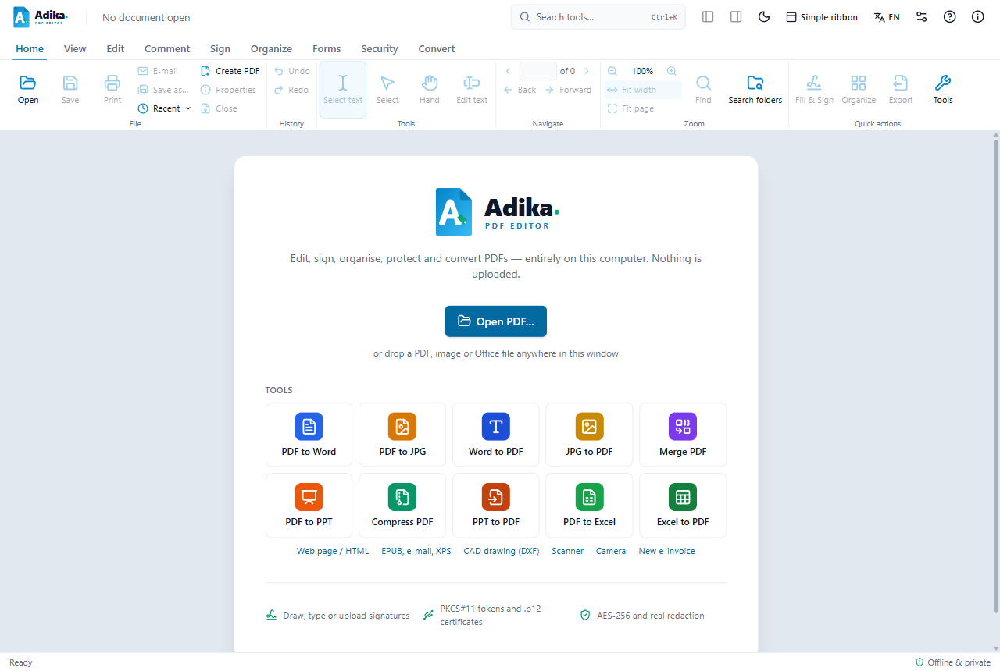
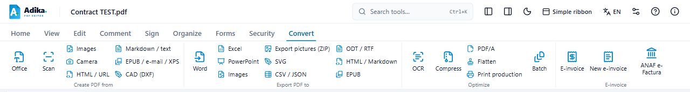

# Getting started

This page shows how to open documents, find your way around the window, save your work and get it back after a crash.

## The welcome screen

The first time you start Adika, a welcome window opens over the start screen. Everything Adika does happens on your computer: it works offline and your documents are never uploaded.

Under **What would you like to do?** you can start one of the most common tasks straight away:

- **Sign a PDF**: choose the PDF, then place your handwritten signature (Fill & Sign). For a digital signature with a certificate or token, see [Sign a document](signing-sign.md).
- **Create an e-Factura**: opens the invoice editor. See [Create an invoice](efactura-create.md).
- **Edit text in a PDF**: choose the PDF, then click any line of text and type. The new text is written in the document's own font.
- **Combine PDF files**: choose several PDFs, put them in the order you want and click the **Merge** button below the list.
- **Fill in a form**: choose the PDF; the form fields open in the panel on the right. You can also type straight into the fields on the page.
- **Convert to Word or Excel**: opens the Tools window (PDF to Word, PDF to Excel, PDF to JPG, Word to PDF…).

**How it works** under each task opens the matching page of this guide. In the same window you can choose the **interface language** and the **ribbon** (simple or full, see below).

Leave **Don’t show this again** ticked and click **Get started** to close the window for good; untick it to see the window at every start. You can open it again at any time: **Help** (F1) → **Welcome screen**, or type "welcome" in **Search tools…** (Ctrl+K).

## Simple and full ribbon

The ribbon is the band of commands at the top of the window. It has two forms:

- The **simple ribbon** shows about twenty of the most common commands in one row, grouped by task: **File** (Open, Save, Print, E-mail), **Edit & comment** (Edit text, Add text, Highlight, Note), **Sign** (Fill & Sign, Digital signature, Sign many files, Verify), **Pages** (Combine PDFs, Organize, Compress, OCR), **Convert**, **Protect** (password, redaction, hidden information) and **e-Factura** (new invoice, open an invoice, ANAF). Buttons with a small arrow open a menu.
- The **full ribbon** has every command, in tabs (see the table below).

New installations start with the simple ribbon; if you used Adika before, you keep the full ribbon. To switch:

- click **More tools** at the right end of the simple ribbon for the full ribbon;
- click **Simple ribbon** on the **View** tab of the full ribbon to go back;
- or click the **Simple ribbon** button at the top of the window: it switches both ways.

Adika remembers your choice. **Search tools…** (Ctrl+K) always finds every command, also in the simple ribbon: when a command is only in the full ribbon, Adika shows its tab for a while and runs it; **Back to the simple ribbon** (at the right, next to the tabs) returns. Your Quick Access toolbar works in both ribbons.

When the window is too narrow for a tab, some groups fold into a single button with the group's name: click it to see the group's commands.

## Open a document

- Click **Open** on the **Home** tab, or press **Ctrl+O**, and choose a file.
- Or drag a file from File Explorer anywhere into the Adika window.
- **Recent** (on the Home tab) lists the files you opened lately.

Adika opens PDF files, pictures (JPG, PNG, HEIC, TIFF…), Office documents (Word, Excel, PowerPoint, when Microsoft Office is installed) and electronic invoices (e-Factura XML files and the ZIP files you download from ANAF's SPV). Pictures, Office documents and invoices are turned into a PDF as they open; the original file is not changed.

If a PDF is protected with a password, Adika asks for it.

## The ribbon at a glance

In the full ribbon the commands are grouped in tabs at the top of the window:

| Tab | What you find there |
| --- | --- |
| **Home** | Open, Save, Print, E-mail, Undo / Redo, selecting text, zoom, Find, Fill & Sign |
| **View** | Page layout, rotating the view, reading mode, read aloud, the side panels (pages, bookmarks, attachments, comments) |
| **Edit** | Editing text, adding text, pictures, links, headers and footers, drawing shapes |
| **Comment** | Notes, highlighting, stamps, drawings, the list of comments |
| **Sign** | Your handwritten signature (Fill & Sign), digital signatures with a certificate, token, Windows certificate or cloud signature, **Sign many files**, **Verify** |
| **Organize** | Pages: insert, delete, move, rotate, split, combine files |
| **Forms** | Form fields, filling in, detecting fields |
| **Security** | Passwords, permissions, redaction (blacking out), removing hidden information, accessibility |
| **Convert** | PDF to Word, Excel, pictures; PDF/A; OCR; compressing; **E-invoice**, **New e-invoice**, **ANAF e-Factura** |

Do not know where a command is? Click **Search tools…** at the top of the window (or press **Ctrl+K**) and type what you want to do, for example "e-invoice" or "sign".

Most buttons show a short explanation when you hold the mouse over them. Press **Alt** to move to the ribbon with the keyboard, then the arrow keys and Enter (in the simple ribbon: Tab and Enter).

## Save your work

- **Save** (Ctrl+S) writes the changes into the file you opened.
- **Save as…** (Ctrl+Shift+S) writes a copy under a new name and leaves the original as it was.
- A dot (●) next to the file name means there are unsaved changes.

Documents that came from an invoice, a picture or an Office file have no PDF on disk yet: the first Save asks where to put the new PDF.

> **Signed documents.** When you save a PDF that carries digital signatures, Adika adds your changes at the end of the file (an "incremental update") so the signatures stay valid. Some changes cannot be added that way; Adika then warns you before saving. See [Signing problems](signing-troubleshooting.md#saving-will-invalidate-the-signatures).

## Undo and redo

- **Undo** (Ctrl+Z) takes back the last change; press it again to go further back.
- **Redo** (Ctrl+Y) brings a change back.

Undo works for edits, comments, page changes, find & replace and redaction until you close the document.

## Several documents: tabs

Every document opens in its own tab under the ribbon.

- Click a tab to switch to it, or press **Ctrl+Tab** (and **Ctrl+Shift+Tab** to go back).
- **Ctrl+W** closes the current document. Adika asks first if it has unsaved changes.
- The **+** next to the tabs opens another file.
- Drag a tab out of the window to open that document in a window of its own.

## After a crash

Adika keeps an automatic backup of every document with unsaved changes, a few seconds after each change. If Adika or Windows stops unexpectedly, the next time you start Adika the window **Recover unsaved documents** lists those documents with the time of their last backup.

1. Tick the documents you want back.
2. Click **Recover**. They open as they were at the last backup.
3. Save them (Save as… is safest).

**Discard** deletes the backups. When you close Adika normally, its backups are removed.

## Language and appearance

- The **language button** at the top right (it shows the current language, for example **EN**) switches the interface between English, Română, Deutsch, Français, Magyar, Italiano and Español. This guide is available in English and Romanian; with the other languages it is shown in English.
- The **moon / sun** button switches between light and dark mode.
- The **i** button (About) shows the version, keyboard shortcuts, updates and saving options.

## Drag and drop

Drag files from Explorer onto Adika. PDFs open in tabs; dropped on the page thumbnails or on a page, Adika asks whether to insert their pages there or open them in a new tab. A picture dropped on a page is placed where you let go. Office and other files are converted to PDF first. Drag a page thumbnail onto another document's tab, wait until it opens, then drop the page among its thumbnails to copy it there. The Batch and Sign many files lists also take dropped PDFs and folders.

## Report a problem

In **About** (the **i** button) or at the bottom of the help, choose **Report a problem** or **Suggest a feature**. Adika shows the text it will put into a new GitHub issue: the Adika and Windows versions, the interface language and whether Adika is installed or portable. Your documents, file names and folders are never included, and nothing is sent until you submit the issue on GitHub yourself. **Copy text** copies the same text, for example for your IT department when your organisation does not allow opening GitHub.

After a crash, Adika offers **Report this crash** the next time it starts. Folders, document names and your Windows user name are removed from the report first; read it, change it if you wish, and then open GitHub. You can turn these offers off.

## Next steps

- [Read a received e-Factura](efactura-read.md)
- [Create an invoice](efactura-create.md)
- [Sign a document](signing-sign.md)
