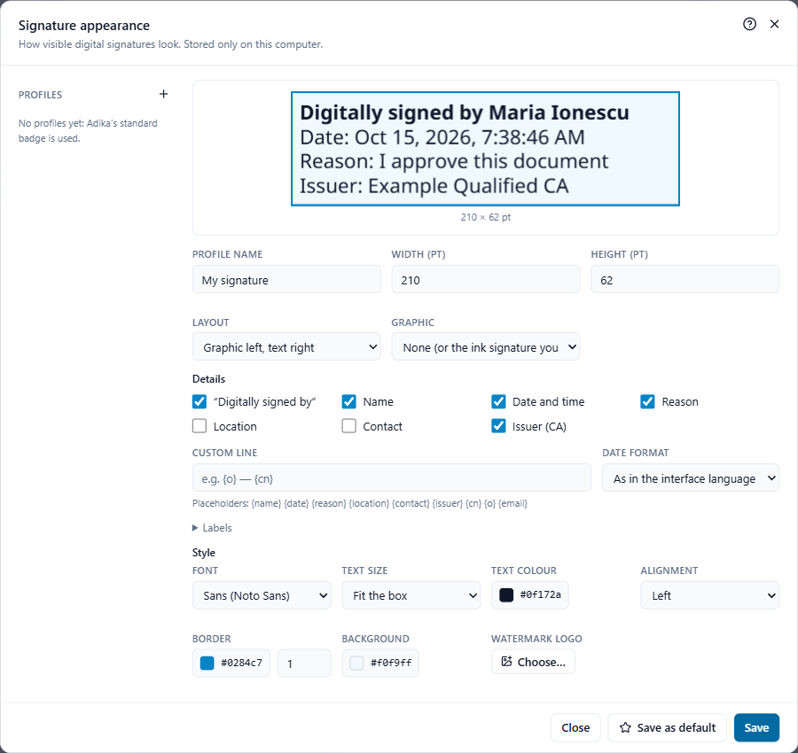

# Visible signatures and the appearance designer

A digital signature can be **visible** (a box on the page with your name, the date and, if you like, your handwritten signature or logo) or **invisible** (nothing on the page; the signature is listed in the signature panel and in **Verify**). Both are equally valid. Visible signatures are easier for people who print the document.

## Where the signature appears

In every signing dialog, **Visible signature** offers:

- **Bottom-right corner**, **Bottom-left corner**, **Top-right corner**, **Top-left corner** of the page chosen in **Page**. The box is 210 × 62 points (about 7.4 × 2.2 cm), 28 points from the edges.
- **On the selected ink signature**: when you placed your handwritten signature with **Fill & Sign** and selected it, the digital signature takes its place and size; your handwriting becomes the picture of the digital signature.
- **In the selected signature field**: when a signature field you drew is selected (see below).
- **Invisible (no visible badge)**.

To put the signature at an exact place, first place your handwritten signature there (or draw a signature field there), select it, then open the signing dialog.

## Signature fields

A signature field is an empty box where someone is to sign, for example on a contract you send out.

**Add a field:** click **Sign → Signature field**, then drag a rectangle on the page. Save the document and send it. Whoever receives it signs in that box with their own program.

**Sign in a field you drew in Adika:** click the field with the **Select** tool so it is selected, open the signing dialog and keep **In the selected signature field**.

**Sign in an empty field of a PDF you received:** use **Sign → Sign many files** with that one file, and tick **Sign into an empty signature field when the file has one named:** with the field's name (often `Signature1`; ask the sender if you are not sure). See [Sign many files](signing-batch.md). In the single-document dialogs, place the signature over the field with a corner position or on an ink signature instead.

## Choose an appearance

Under **Visible signature**, **Appearance** offers:

- **Standard badge**: Adika's box with "Digitally signed by", your name, the date, the reason and the issuer.
- your own **profiles**, made in the designer; the default one is marked ★.

## The appearance designer

Click **Design appearance…** in any signing dialog.

The preview at the top shows the box with sample values; it changes as you edit. On the left, **Profiles** lists your saved designs (the **+** makes a new one; point at a profile to duplicate or delete it).

**Size and layout**

- **Profile name**, **Width (pt)** and **Height (pt)** (72 points = 2.54 cm). When you sign on an ink signature or in a field, the box takes their size instead.
- **Layout**: **Graphic left, text right**, **Graphic on top, text below**, **Text only**, **Graphic only**.

**Graphic**

- **None (or the ink signature you sign on)**.
- **Handwritten signature or logo**: one of your saved signatures, or **Image file…** (PNG, JPEG).
- **My name in a script font**: your name written in a handwriting-style font installed in Windows, in the colour you choose.

**Details**: tick what the text shows: "Digitally signed by", **Name**, **Date and time**, **Reason**, **Location**, **Contact**, **Issuer (CA)**.

- **Custom line**: your own text, with placeholders filled in at signing: `{name}` `{date}` `{reason}` `{location}` `{contact}` `{issuer}` `{cn}` `{o}` `{email}`. For example `{o} — {cn}` gives the organisation and name from the certificate.
- **Date format**: as in the interface language, or one of the fixed formats.
- **Labels**: change the words in front of the values (for example "Semnat digital de").

**Style**: **Font**, **Text size** (**Fit the box** shrinks the text to fit), **Text colour**, **Alignment**, **Border** (colour and width, or none), **Background**, and a **Watermark logo** with its opacity behind the text.

Click **Save** to keep the profile, or **Save as default** to use it automatically from now on. Profiles are stored only on this computer.

## What ends up in the PDF

The visible box is drawn with real text (it can be selected and searched), upright even on turned pages. The name, issuer and date are taken from the certificate and the signing time; what proves the signature is the certificate, not the picture.

Next: [Sign many files](signing-batch.md)
