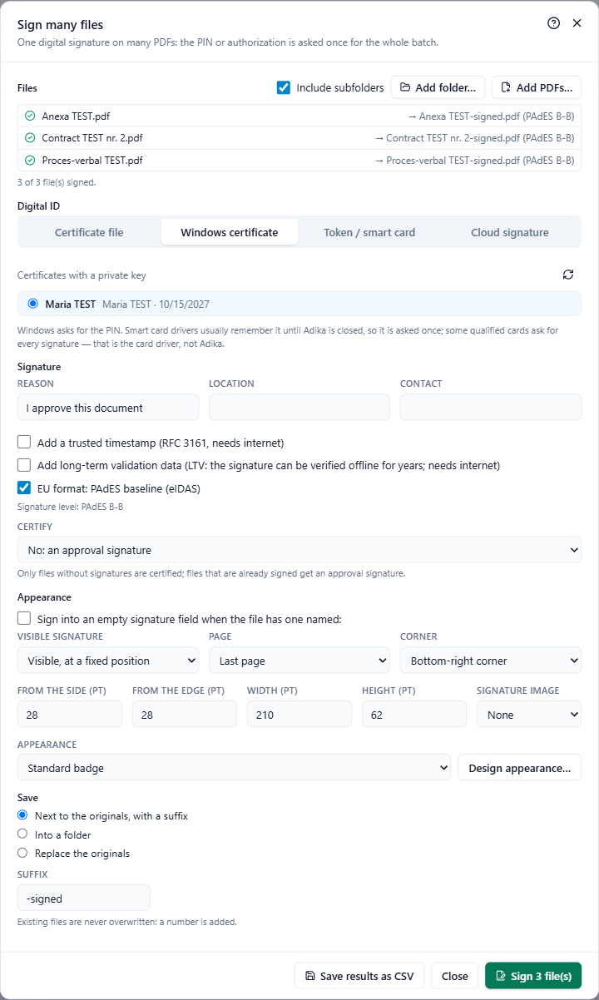

# Sign many files at once

**Sign → Sign many files** puts the same digital signature on many PDFs in one go: a folder of contracts, the month's invoices, a set of reports. You type the PIN or password **once** for the whole batch. No document needs to be open.

## 1. Choose the files

- **Add folder…** adds every PDF in a folder; tick **Include subfolders** to include the folders inside it.
- **Add PDFs…** adds single files. You can add from several places.
- The bin next to a file removes it from the list.

## 2. Choose the digital ID

The **Digital ID** tabs are the same four places as for one document (see [Sign a document](signing-sign.md)):

- **Certificate file**: choose the .pfx / .p12 file, type the password, **Unlock**. The password is kept only while this window is open.
- **Windows certificate**: choose the certificate. Windows asks for the PIN. Most card drivers remember it until Adika is closed, so you type it once; some qualified cards ask for it at every signature. That is the card driver's rule, not Adika's.
- **Token / smart card**: choose the driver and the certificate and type the **Token PIN**. Adika logs in to the token once for the whole batch and logs out at the end. Some qualified keys require the PIN for every single signature; Adika then gives it to the token each time until the batch ends. The PIN is never stored.
- **Cloud signature**: the provider must already be added in **Sign → Cloud signature**. Sign in, choose the certificate, type the PIN and the one-time code. One authorisation covers several files; when your provider allows only a limited number of signatures per authorisation, Adika asks for a new one-time code for the next group of files.

## 3. Signature options

**Reason**, **Location**, **Contact**, the trusted timestamp, long-term validation, the archive timestamp and **EU format: PAdES baseline (eIDAS)** work as for one document; the level is shown under them. See [Signatures explained](signing-concepts.md#pades-levels).

**Certify**: only files without signatures are certified; files that are already signed get an approval signature.

## 4. Appearance

- **Sign into an empty signature field when the file has one named:** type the field name (for example `Signature1`). Files with an empty field of that name are signed in the field; the others get the signature set below (**Otherwise**).
- **Visible signature**: **Visible, at a fixed position** or **Invisible (no visible badge)**.
- **Page**: **First page**, **Last page** or **Page number**.
- **Corner**, then **From the side (pt)** and **From the edge (pt)**: the distance from the corner. **Width (pt)** and **Height (pt)**: the size of the box (72 pt = 2.54 cm).
- **Signature image**: one of your saved handwritten signatures, or **None**.
- **Appearance**: the standard badge or one of your profiles; **Design appearance…** opens the designer (see [Visible signatures](signing-appearance.md)).

## 5. Where the signed files go

Under **Save**:

- **Next to the originals, with a suffix**: `contract.pdf` becomes `contract-signed.pdf` in the same folder. Change the **Suffix** if you like.
- **Into a folder**: click **Choose…**; the signed files keep their names (the suffix may be empty there).
- **Replace the originals**: Adika asks for confirmation. Each original is replaced only after its signed version is complete; files that fail or are skipped stay as they are.

Existing files are never overwritten: a number is added to the name.

## 6. Sign

Click **Sign N file(s)**. While it runs, the list shows each file's result and **Stop after this file** ends the batch after the current file.

When it is done:

- ✓ files show the name of the signed copy and the signature level,
- skipped and failed files show the reason,
- the summary says for example **3 of 3 file(s) signed.**

**Save results as CSV** saves the list (file, status, output, details) for your records; it opens in Excel.

## Files that are skipped

| Reason shown | Why |
| --- | --- |
| password-protected | Encrypted PDFs are not signed in a batch. Open the file, remove the password, and sign it on its own. |
| certified with "no changes allowed" | Another signature would break the existing certification. |
| there is no page N in this file | You chose a page number the file does not have. |
| no empty field "…" (a note) | The file had no empty field with that name; it was signed at the fixed position instead. |
| not signed: signing stopped after the error above | The digital ID failed (wrong PIN, token removed, provider error). Adika stops at the first such error so a locked token is not tried again and again. Fix the cause and sign the remaining files. |

## For IT: the command line

Administrators can sign from scripts without opening the window: `adika-pdf-editor.exe --batch --sign …` with a .pfx file (`--pfx`, password in the environment variable `ADIKA_PFX_PASSWORD`) or a Windows certificate (`--thumbprint`). Run `adika-pdf-editor.exe --batch --help` for the full list of options.
