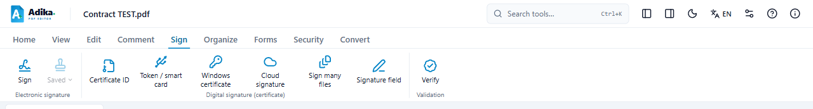
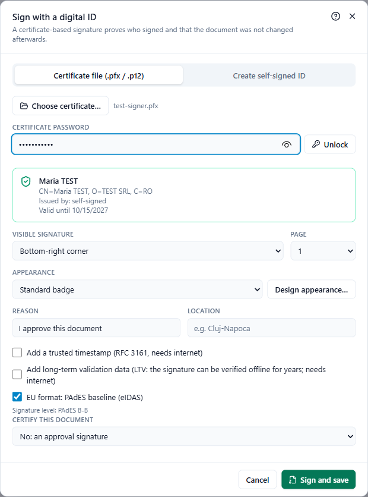
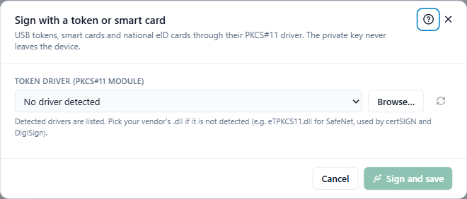
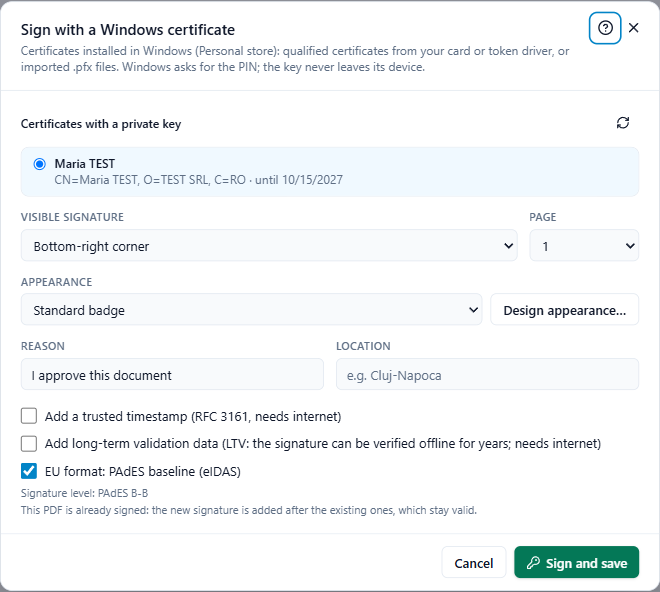
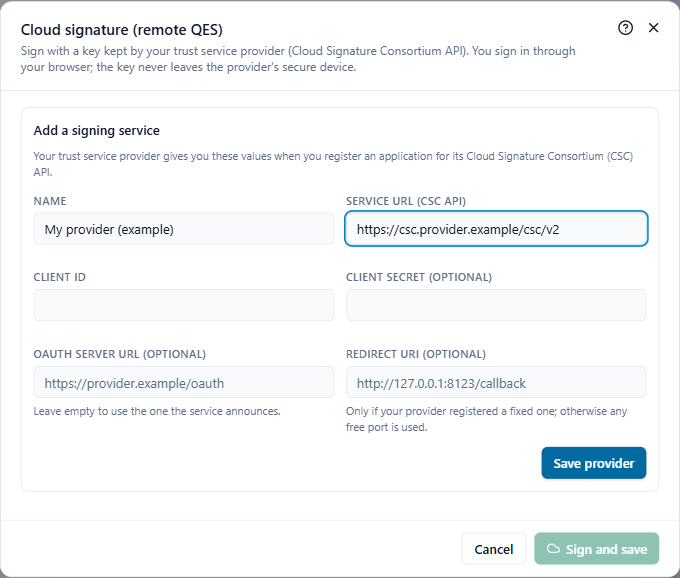

# Sign a document

Open the PDF and click the **Sign** tab. The **Digital signature (certificate)** group has one button for each place your certificate can be:

- **Certificate ID**: a .pfx / .p12 file, or a new self-signed ID.
- **Token / smart card**: a USB token or card, through its driver (PKCS#11).
- **Windows certificate**: a certificate installed in Windows.
- **Cloud signature**: a remote qualified signature at your provider.

Not sure which one you have? A qualified certificate on a token usually works both as **Token / smart card** and as **Windows certificate** (when the vendor's software is installed). **Windows certificate** is the simplest to try first.

## Before you sign

- Finish your edits. Adika signs the document as it is on screen and saves the result as a **new file** (it suggests the name with `-signed` at the end, then opens it). The file you opened is not changed.
- A document that is already signed can be signed again; earlier signatures stay valid. Save or undo your other changes first: Adika refuses to add a signature on top of unsaved edits to a signed PDF, because those edits would break the earlier signatures.

## Sign with a certificate file (.pfx or .p12)

1. Click **Sign → Certificate ID**.
2. On the **Certificate file (.pfx / .p12)** tab click **Choose certificate…** and choose the file.
3. Type the **Certificate password** and click **Unlock** (or press Enter). A card shows the owner, the issuer and the expiry date.
4. Choose where the signature appears and the options (see [The common options](#the-common-options)).
5. Click **Sign and save**.

**Create self-signed ID** makes a certificate on the spot with the name you type. It proves the document was not changed after signing, but not *who* signed: readers see "self-signed, not verified". Use it for tests or internal documents; **Save ID as .p12** keeps it for later.

## Sign with a USB token or smart card

1. Plug in the token or insert the card.
2. Click **Sign → Token / smart card**.
3. **Token driver (PKCS#11 module)**: Adika lists the drivers it finds. If yours is not listed, click **Browse…** and choose the vendor's `.dll` (for example `eTPKCS11.dll` for SafeNet tokens, used by certSIGN and DigiSign). Your provider's installation guide names the file.
4. The tokens and their certificates appear; choose the certificate.
5. Type the **Token PIN**. It is used for this one signature and never stored. If your card reader has its own keypad, you type the PIN there instead.
6. Choose the options and click **Sign and save**.

> Tokens lock after a few wrong PINs (often 3). If Adika says the PIN is wrong, check the keyboard language and Caps Lock before you try again.

## Sign with a certificate installed in Windows

Qualified certificates on tokens and cards usually appear in Windows once the vendor's software is installed. A .pfx file can also be installed in Windows (double-click it).

1. Click **Sign → Windows certificate**.
2. Choose a certificate from **Certificates with a private key**. Qualified certificates are marked **Qualified** or **Qualified (QSCD)**; expired ones **Expired**.
3. Choose the options and click **Sign and save**. **Windows** asks for the PIN, in its own window.

## Sign with a cloud signature provider

Cloud (remote) signatures use the **Cloud Signature Consortium (CSC) API**, a standard many European providers offer. Your certificate stays at the provider.

**What to ask your provider for** (once):

- the **Service URL** of their CSC API (often ends in `/csc/v2` or `/csc/v1`),
- a **Client ID** (and a **Client secret**, if they use one) for a desktop application,
- whether they need a fixed **Redirect URI**; if so, use one of the form `http://127.0.0.1:8123/callback` and give it to them,
- whether you confirm signatures with a PIN, a one-time code (SMS / app) or in the browser.

**Add the provider:** click **Sign → Cloud signature**. The first time the form **Add a signing service** opens: fill in **Name**, **Service URL (CSC API)**, **Client ID** and, if given, the other fields; click **Save provider**.

**Sign:**

1. Choose the **Signing service** and click **Sign in**. Your browser opens the provider's sign-in page; sign in there.
2. Back in Adika, your signing certificates are listed. Choose one.
3. If asked, type the **PIN**, and the **One-time code** (press **Send code** to receive it by SMS, e-mail or app). Some providers ask you to confirm each signature in the browser instead.
4. Choose the options and click **Sign and save**.

The PIN and code are sent only to your provider and never stored. You stay signed in until you close Adika or click **Sign out**.

> **Please note.** Cloud signing has been tested against a simulated CSC service, not yet against every provider. If your provider's service does not work with Adika, please report it.

## The common options

All signing dialogs end with the same options:

- **Visible signature**: **Bottom-right corner** (and the other corners) of the chosen **Page**, **On the selected ink signature** / **In the selected signature field** when one is selected on the page, or **Invisible (no visible badge)**. See [Visible signatures](signing-appearance.md).
- **Appearance**: the look of the visible signature; **Design appearance…** opens the designer.
- **Reason** (by default "I approve this document") and **Location**.
- **Add a trusted timestamp (RFC 3161, needs internet)** and the **Timestamp authority URL**: your provider's timestamp server, or the default one.
- **Add long-term validation data (LTV…)** and **Add an archive timestamp…**.
- **EU format: PAdES baseline (eIDAS)**: the line under it shows the level (B-B, B-T, B-LT, B-LTA). See [Signatures explained](signing-concepts.md#pades-levels).
- **Certify this document**: only for the first signature. See [Approval and certification](signing-concepts.md#approval-and-certification-signatures).

## After signing

The signed copy opens. Click **Sign → Verify** to see the signature as others will see it: see [Verify signatures](signing-verify.md). If something went wrong, see [Signing problems](signing-troubleshooting.md).
