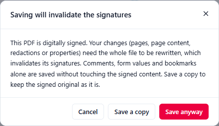

# Signing problems

## PIN and password

- **"Incorrect PIN. Careful: tokens lock after a few wrong attempts."** Check Caps Lock and the keyboard language (a Romanian or English keyboard puts some characters in different places). Most tokens lock after 3 wrong PINs.
- **"The token PIN is locked. Unlock it with your vendor's tool (PUK)."** Use your provider's token software (SafeNet Authentication Client, for example) with the PUK, or contact the provider.
- **"Wrong password for this certificate file."** The .pfx / .p12 password is wrong. It is the password chosen when the file was exported, not your Windows password.
- **Windows asks for the PIN at every signature.** That is how some qualified cards are set up (the driver, not Adika). With **Sign many files** and **Token / smart card**, Adika supplies the PIN for you during the batch.

## Token or card not found

- **"No driver detected"** or **"No token found. Insert your token or card and press refresh."** Plug in the token, wait until Windows has recognised it, then click the refresh button. Install your provider's token software if you have not.
- **The driver is not in the list.** Click **Browse…** and choose the PKCS#11 `.dll` file named in your provider's guide (for example `eTPKCS11.dll` for SafeNet tokens, usually in `C:\Windows\System32`).
- **"Could not load …"** Adika is a 64-bit program and needs the **64-bit** driver. Files in `C:\Windows\SysWOW64` or `Program Files (x86)` are usually 32-bit.
- **"No certificates visible on this token."** The certificate may be on another slot of the card, or the token is empty. Try **Windows certificate** instead.
- **The Windows certificate list is empty.** The message says: "No certificate with a private key is installed." Install your token or card software (it copies the certificate to Windows), or double-click your .pfx file to install it.
- **"The certificate uses an unsupported key type."** Adika signs with RSA and ECDSA keys only.

## The signature is amber or red in Verify

- **Self-signed — not verified**: the certificate was made by its owner (for example **Create self-signed ID**). Normal for tests; not proof of identity.
- **Not trusted on this computer** or **Chain incomplete**: Windows does not know the issuer's root certificate. For EU qualified certificates, click **Download** in the EU Trusted Lists bar of **Verify**, then **Verify again**. For other issuers, install the issuer's root certificate in Windows if you trust it (ask your IT department).
- **Certificate not valid at the validation time**: the certificate had expired (or was not yet valid) when it was checked. A signature with a **trusted timestamp** made while the certificate was valid stays valid after the certificate expires; without a timestamp, the check uses the current time.
- **REVOKED**: the issuer withdrew the certificate. The signature cannot be trusted.
- **MODIFIED — signature broken** or **No — content was changed after this signature**: see [Verify signatures](signing-verify.md#the-rows-of-the-card).

## Expired certificate

The identity card in the signing dialog shows **Expired** in red. Signatures you make with it will be shown as not valid. Renew the certificate with your provider. Signatures you made **before** it expired stay valid; those with a trusted timestamp or long-term validation can still be checked many years later.

## Timestamp and long-term validation

- **"The timestamp server … answered HTTP …"** or a network error: the timestamp server cannot be reached. Check the internet connection, try again later, or use your provider's timestamp server in **Timestamp authority URL**. Some offices need a proxy; ask IT.
- **"The timestamp server rejected the request"**: some servers need an account. Use the one your provider gives you.
- **"Signed. Long-term validation is incomplete: …"** The document is signed; only some validation data could not be fetched (for example an issuer's revocation server did not answer). You can add it later with **Verify → Add long-term validation**.
- **"Timestamping is turned off by your organisation."** / **"Checking certificates online is turned off by your organisation."** Online features are switched off by policy; the options are greyed out.

## Saving will invalidate the signatures

When you change a signed PDF and save, Adika normally adds the changes at the end of the file (an incremental update) so the signatures stay valid. That works for **comments**, **form values** and **bookmarks**.

Changes to **pages** (adding, deleting, moving, rotating), **page content** (text, pictures, drawings), **redactions** or **document properties** need the whole file to be rewritten. Adika then asks first:

- **Save a copy** keeps the signed original and saves your changed version as a new file. Usually the right choice.
- **Save anyway** overwrites the file; its signatures will show as broken.
- **Cancel** saves nothing.

If you want to sign **after** your changes, save a copy first, then sign the copy.

Also: **"This PDF already carries digital signatures and has unsaved edits."** Adika will not add a signature on top of unsaved changes to a signed PDF. Save a copy (or undo the changes), then sign.

## Organisation rules

- **"Your organisation does not allow signing with certificates from this issuer: …"** Your IT department allows only certificates from certain issuers. Use a certificate from one of them.
- **"Remote (cloud) signing is turned off by your organisation."** Cloud signatures are switched off by policy.

## Cloud signature

- **"This account has no signing credentials."** You signed in with an account that has no certificate at the provider, or the certificate is not activated yet.
- A certificate marked **Expired**, **Key disabled** or **Unsupported key type** cannot be used; contact the provider.
- The browser does not come back to Adika after sign-in: make sure the redirect address registered with the provider matches the one in **Edit provider** (or leave it empty if the provider accepts any local port), then click **Sign in** again.
