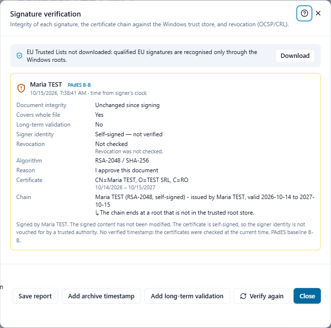

# Verify signatures

When you open a signed PDF, Adika checks its signatures and shows the result at the bottom right of the window, for example **1 signature · intact** in green, or **· problem** in red. Click it, or click **Sign → Verify**, to see the details.

## Green, amber, red

Each signature has a card with a coloured border:

- **Green**: the document is unchanged since signing and the signer's certificate is trusted (it leads to a trusted root in Windows or to the EU Trusted Lists), with no warnings.
- **Amber**: the document is unchanged, but Adika cannot confirm who signed: the certificate is self-signed, its chain is incomplete, it is not trusted on this computer, it was not valid at the time of signing, or there are warnings (read them). The content is intact; the identity needs your judgement.
- **Red**: the signature is broken (the document was **modified** after signing), or the certificate is **revoked**. Do not rely on this document; ask the sender for a new copy.

The line under the name tells you where the signing time comes from: **trusted timestamp** (a timestamp server confirmed it), **timestamp not verified**, or **time from signer's clock** (only the signer's computer says so).

## The rows of the card

- **Document integrity**: **Unchanged since signing**, or **MODIFIED — signature broken**.
- **Covers whole file**: **Yes** when nothing was added after this signature. When something was added, Adika checks what:
  - **Allowed changes after signing:** followed by **validation data**, **more signatures**, **form filling** or **comments**. These are normal: other people signed after you, or someone filled in a form the signer allowed to be filled in.
  - **No — content was changed after this signature**, with the reasons (for example a page or its text was changed). The signature covers an older version of the document; what you see is not what was signed.
- **Certified**: shown for certification signatures, with what they allow.
- **Long-term validation**: whether the validation data is saved in the file.
- **EU qualified**: **Qualified electronic signature** (qualified certificate on a qualified device), **Advanced signature, qualified certificate**, or **Issuer is a qualified trust service**, confirmed by the EU Trusted Lists. **Declared by the certificate, not confirmed** means the lists are not downloaded.
- **Signer identity**: **Trusted (EU Trusted List)**, **Trusted (chain to a Windows root)**, **Self-signed — not verified**, **Chain incomplete**, **Not trusted on this computer** or **Certificate not valid at the validation time**.
- **Revocation**: **Not revoked**, **REVOKED**, **Unknown** or **Not checked**.
- **Algorithm**, **Reason**, **Certificate** (owner and validity) and **Chain** (each certificate up to the root).

## The EU Trusted Lists

The bar at the top of the window is about the **EU Trusted Lists**: the official lists of qualified trust service providers in every EU country. With them, Adika recognises qualified signatures from the whole EU, not only those whose root certificate is in Windows.

- Click **Download** the first time (and **Update** now and then). Adika downloads the lists from the European Commission, checks their signatures and keeps them on this computer.
- Lists whose signature does not verify are not used and are named in the bar.

## Revocation

A certificate can be withdrawn (revoked) before it expires, for example when a token is lost. Tick **Check revocation online (OCSP / CRL)** and click **Verify again** to ask the issuer. Without internet, Adika uses the validation data saved in the file, if any.

## Buttons

- **Verify again** runs the checks again (after downloading the Trusted Lists or ticking the revocation check).
- **Save report** saves a PDF report of what was checked, with the name of the file and `-validation` added. Useful for your files or to send to someone.
- **Add long-term validation** stores the certificate chains and revocation answers in the file, so the signatures can be verified offline years from now. The signatures stay valid.
- **Add archive timestamp** adds validation data and a timestamp over the whole file (PAdES B-LTA). Repeat it every few years for documents you must keep for a long time.

The last two need internet and change the file: save or undo other changes first.

## Document timestamps

A **Document timestamp** card is not a person's signature: it is a timestamp over the whole file, usually an archive timestamp. It shows the timestamp authority instead of a signer.

Next: [Signing problems](signing-troubleshooting.md)
