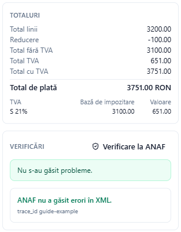
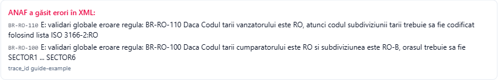

# Verificarea unei facturi la ANAF

Adika verifică fiecare factură după regulile e-Factura pe care le cunoaște, chiar în timp ce o completați. ANAF aplică propriul set complet de reguli la încărcare. **Verificare la ANAF** trimite mai întâi XML-ul la serviciul public de validare al ANAF, astfel încât să vedeți răspunsul ANAF înainte ca factura să devină oficială.

Verificarea:

- are nevoie de conexiune la internet,
- **nu** are nevoie de cont SPV, de certificat sau de conectarea la SPV,
- **nu** înregistrează și nu transmite factura: ANAF doar citește XML-ul și răspunde,
- trimite la ANAF tot XML-ul facturii (de aceea pornește doar când apăsați butonul).

## Verificarea unei facturi noi

1. Completați factura în **Conversie → Factură electronică nouă** până când lista **Verificări** nu mai arată erori roșii (butonul este inactiv cât timp Adika însuși mai găsește erori).
2. Faceți clic pe **Verificare la ANAF** în caseta **Verificări**.
3. După câteva secunde, răspunsul ANAF apare sub verificările Adika.

- **ANAF nu a găsit erori în XML.** Factura trece de validarea ANAF. O puteți emite și trimite.
- **ANAF a găsit erori în XML:** urmat de mesajele ANAF. Fiecare mesaj începe cu regula aplicată de ANAF, de exemplu **BR-RO-110** sau **BR-CO-15**. Vedeți [Probleme e-Factura](efactura-troubleshooting.md#mesajele-de-eroare-anaf) pentru semnificația regulilor frecvente.
- Rândul mic **trace_id** este referința ANAF pentru această verificare. Păstrați-l dacă aveți nevoie să întrebați ANAF despre un rezultat.

Dacă modificați factura după verificare, Adika afișează **Factura s-a modificat după verificarea ANAF.** Verificați din nou înainte de trimitere.

## Verificarea unui fișier XML existent

Puteți verifica orice XML e-Factura, de exemplu unul produs de alt program:

1. Faceți clic pe **Conversie → ANAF e-Factura**.
2. În fila **Trimitere**, faceți clic pe **Alegeți XML…** și alegeți fișierul.
3. Faceți clic pe **Verificare la ANAF**.

Răspunsul apare sub butoane. Nu se încarcă nimic; butonul **Trimitere la ANAF** este separat.

## Ce acoperă verificarea

Serviciul de validare al ANAF aplică aceeași schemă și aceleași reguli de business (EN 16931 și CIUS-RO) ca la încărcare. O factură care trece de verificare trece de regulă și la încărcare. Verificarea nu se uită la contul dumneavoastră SPV: dreptul de a trimite facturi pentru CUI-ul furnizorului se verifică abia la trimitere.

Pentru o notă de creditare, Adika folosește automat validarea ANAF pentru note de creditare (FCN); pentru facturi, validarea pentru facturi (FACT1).

## Când verificarea nu funcționează

- **„Firewall-ul ANAF a respins XML-ul (uneori blochează facturi valide). Încercați din nou mai târziu.”** Protecția ANAF refuză uneori cererile. Așteptați câteva minute și încercați din nou.
- Un răspuns HTTP 5xx al validării ANAF sau niciun răspuns: serviciul ANAF este oprit sau aglomerat. Încercați mai târziu; verificările proprii ale Adika rămân valabile.
- **„Conexiunea cu ANAF este dezactivată de organizația dumneavoastră.”** Departamentul IT a dezactivat funcțiile online. Întrebați-i sau validați XML-ul în alt mod.
- Fără internet: butonul afișează un mesaj de eroare de la Windows. Verificările proprii ale Adika funcționează în continuare fără internet.

Mai departe: [Trimiterea facturilor la ANAF](efactura-anaf-send.md)
