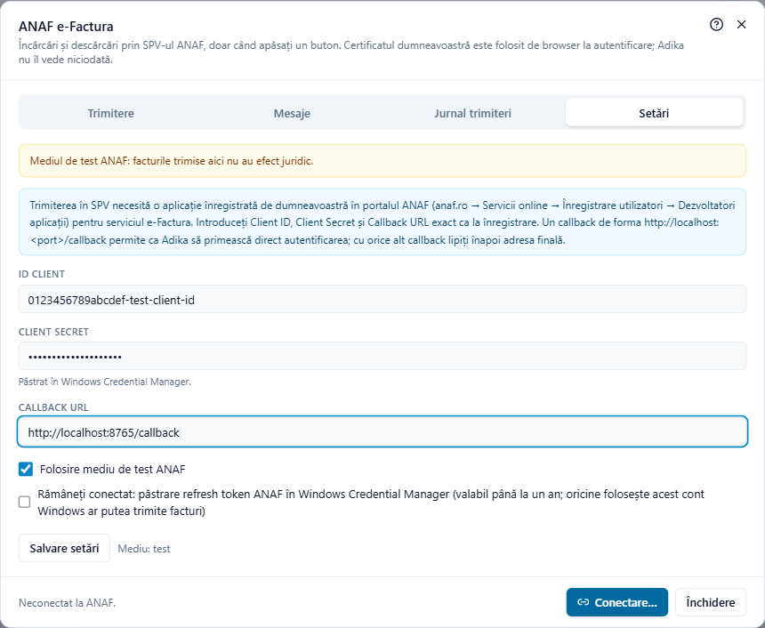
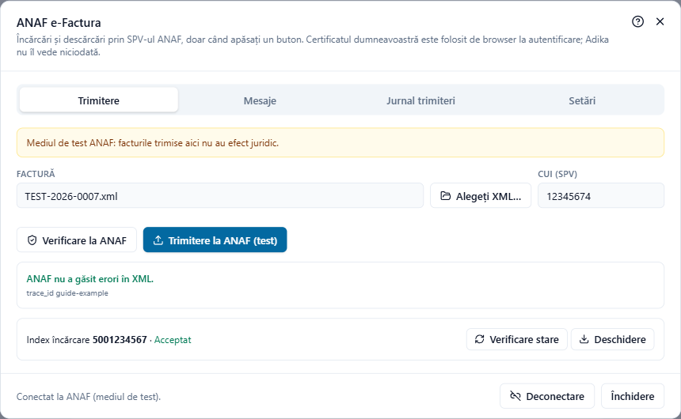
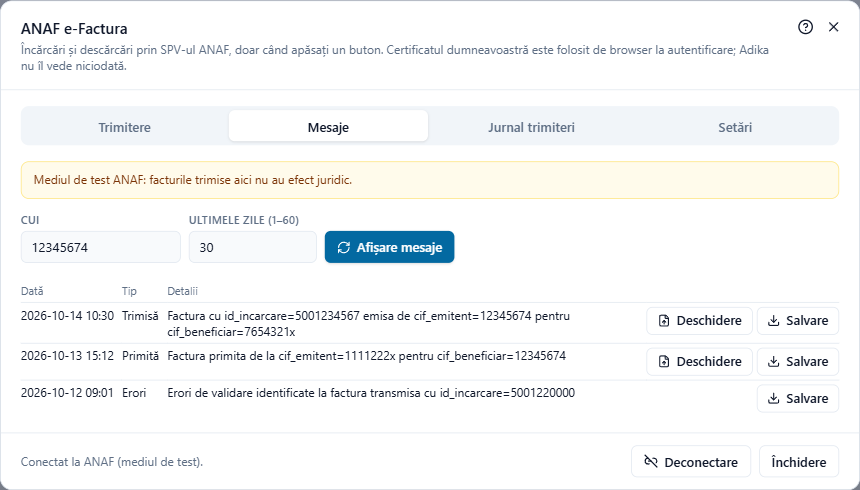
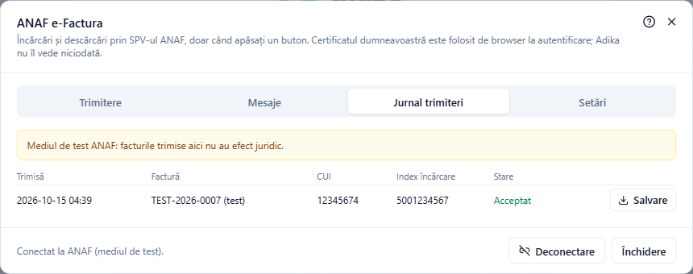

# Trimiterea facturilor la ANAF (SPV)

Fereastra **ANAF e-Factura** (**Conversie → ANAF e-Factura**) încarcă facturile dumneavoastră în SPV-ul ANAF, le urmărește starea și afișează și descarcă facturile trimise și primite. Adika comunică cu ANAF doar când apăsați un buton.

> **Atenție.** Autentificarea în SPV și încărcarea au fost testate cu un ANAF simulat, nu încă pe serverele reale ale ANAF. Încercați mai întâi **mediul de test** (vedeți Pasul 2) și verificați primele încărcări reale și în paginile web ale SPV.

## De ce aveți nevoie

1. **Acces SPV pentru CUI-ul firmei.** Persoana care se autentifică trebuie să fie înregistrată în SPV pentru acel CUI (reprezentant legal sau împuternicit), cu un certificat calificat pe token sau card inteligent.
2. **O aplicație înregistrată la ANAF.** ANAF permite programelor să folosească SPV doar printr-o aplicație pe care o înregistrați *dumneavoastră*. Ea vă oferă un **Client ID** și un **Client Secret**. Pasul se face o singură dată.
3. **Tokenul** cu certificatul, conectat la calculator când vă conectați.

Adika nu vede niciodată certificatul sau PIN-ul acestuia: vă autentificați pe pagina ANAF, în browserul dumneavoastră.

## Pasul 1: înregistrarea aplicației la ANAF (o singură dată)

1. Pe **anaf.ro** mergeți la **Servicii online → Înregistrare utilizatori → Dezvoltatori aplicații**.
2. Autentificați-vă cu certificatul calificat.
3. Înregistrați o aplicație (ANAF o numește profil OAuth):
   - **Denumire**: orice nume pe care îl recunoașteți, de exemplu „Adika – TEST SRL”.
   - **Callback URL**: `http://localhost:8765/callback`. Puteți folosi alt număr de port (între 1024 și 65535) în loc de 8765; important este să scrieți exact aceeași adresă și în Adika.
   - **Serviciu**: bifați **E-Factura**.
4. ANAF afișează **Client ID** și **Client Secret**. Copiați-le pe amândouă într-un loc sigur.

Paginile ANAF se schimbă din când în când; dacă denumirile de mai sus diferă, căutați înregistrarea pentru dezvoltatori (OAuth).

## Pasul 2: setările în Adika

Faceți clic pe **Conversie → ANAF e-Factura** și deschideți fila **Setări** (prima dată se deschide singură).

- **ID client**, **Client Secret** și **Callback URL**: exact ca la înregistrarea la ANAF. Client Secret este păstrat în Windows Credential Manager, nu într-un fișier.
- **Folosire mediu de test ANAF**: SPV-ul de test al ANAF. Facturile trimise acolo nu au efect juridic; o bară galbenă vă amintește acest lucru. Debifați opțiunea pentru facturile reale.
- **Rămâneți conectat**: păstrează autentificarea de lungă durată a ANAF (refresh token) în Windows Credential Manager, ca să nu fie nevoie să vă autentificați cu tokenul de fiecare dată. Este valabilă până la un an; oricine folosește contul dumneavoastră Windows ar putea atunci trimite facturi. Nu o activați pe calculatoare folosite de mai multe persoane.

Faceți clic pe **Salvare setări**.

## Pasul 3: conectarea

1. Conectați tokenul.
2. Faceți clic pe **Conectare…** în partea de jos a ferestrei.
3. Browserul deschide pagina de autentificare ANAF. Alegeți certificatul și introduceți PIN-ul tokenului când vi se cere.
4. Browserul afișează (în engleză) „Sign-in finished. You can close this window and return to Adika PDF Editor.” Partea de jos a ferestrei ANAF arată acum **Conectat la ANAF.**

Cât timp Adika așteaptă (cel mult 5 minute), puteți apăsa **Anulare**.

Dacă adresa de callback **nu** este de forma `http://localhost:<port>/…` (de exemplu o adresă https a firmei), Adika nu poate primi singur răspunsul. După autentificare, browserul ajunge pe acea pagină: copiați întreaga adresă din bara de adrese a browserului, lipiți-o în caseta afișată de Adika și faceți clic pe **Continuare**.

**Deconectare** încheie sesiunea și uită autentificarea păstrată.

## Pasul 4: trimiterea unei facturi

O factură ajunge în fila **Trimitere** în două feluri:

- În **Factură electronică nouă**, bifați **Apoi trimitere la ANAF…** înainte de **Creează factura electronică**; fereastra se deschide cu factura nouă.
- Sau faceți clic pe **Alegeți XML…** și alegeți un fișier XML e-Factura.

1. Verificați **CUI (SPV)**: este preluat din factură (CUI-ul furnizorului; la autofacturare, al cumpărătorului). Trebuie să fie un CUI pentru care aveți drepturi SPV.
2. Opțional: **Verificare la ANAF** (vedeți [Verificarea unei facturi la ANAF](efactura-anaf-check.md)).
3. Faceți clic pe **Trimitere la ANAF** (în mediul de test: **Trimitere la ANAF (test)**).

ANAF răspunde cu un **Index încărcare**: numărul încărcării dumneavoastră. Adika îl trece în jurnalul trimiterilor.

## Pasul 5: urmărirea stării

ANAF prelucrează factura în minutele următoare. Cât timp fereastra este deschisă, Adika întreabă la fiecare 30 de secunde, cel mult 10 minute. **Verificare stare** întreabă imediat.

| Stare | Semnificație |
| --- | --- |
| **Trimisă** / **În prelucrare** | ANAF a primit fișierul și încă îl verifică. |
| **Acceptat** | ANAF a acceptat factura și a transmis-o cumpărătorului. **Deschidere** afișează factura semnată de ANAF. |
| **Respinsă (erori)** | ANAF a găsit erori. **Salvare** păstrează răspunsul ANAF (o arhivă ZIP cu lista erorilor); erorile apar și în fereastră. Factura **nu** a fost transmisă: corectați-o și încărcați-o din nou. |
| **Respinsă la încărcare** | ANAF a refuzat fișierul imediat (de exemplu XML nevalid). |

Puteți închide fereastra: starea poate fi verificată mai târziu din fila **Jurnal trimiteri**.

## Mesaje: facturi trimise și primite

Fila **Mesaje** arată ce păstrează SPV pentru un CUI: facturile trimise, facturile **primite** de la furnizori, rapoartele de erori și mesajele cumpărătorilor.

1. Introduceți **CUI** și **Ultimele zile (1–60)**.
2. Faceți clic pe **Afișare mesaje**.
3. Pentru fiecare mesaj, **Deschidere** afișează factura ca PDF lizibil (vedeți [Citirea unei e-Facturi primite](efactura-read.md)); **Salvare** păstrează arhiva ZIP de la ANAF.

ANAF păstrează mesajele doar 60 de zile. Salvați arhivele ZIP ale facturilor în arhiva dumneavoastră.

## Jurnalul trimiterilor

Fila **Jurnal trimiteri** arată toate încărcările făcute de pe acest calculator: data, numărul facturii, CUI-ul, indexul de încărcare și ultima stare cunoscută. Încărcările aflate încă în lucru au **Verificare stare**; cele încheiate au **Salvare** pentru răspunsul ANAF. Încărcările de test sunt marcate „(test)”.

## Probleme

Erorile de autentificare, mesajele de tip „acces refuzat” și erorile de reguli ANAF sunt explicate în [Probleme e-Factura](efactura-troubleshooting.md).
