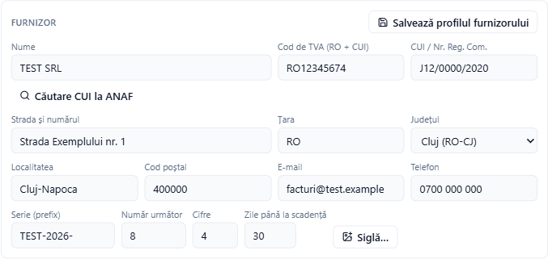
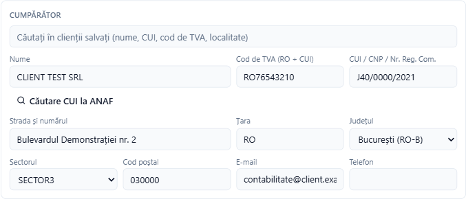
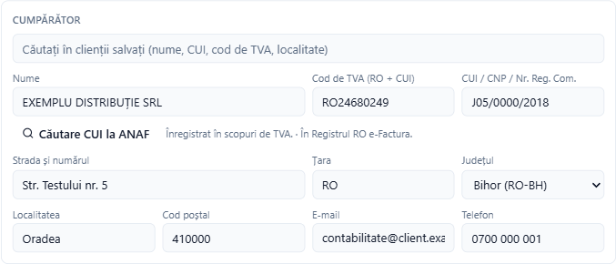
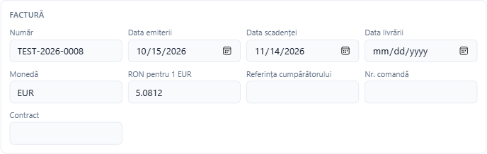
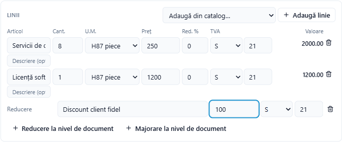
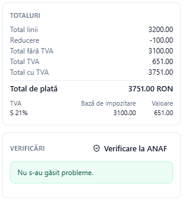
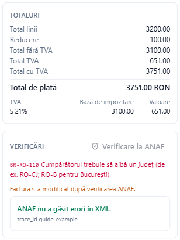

# Emiterea unei facturi

Adika emite facturi e-Factura (și facturi Peppol și Factur-X) pornind de la un formular. Calculează totalurile pe măsură ce scrieți, verifică factura după regulile e-Factura și salvează fișierele alese: XML-ul pentru SPV-ul ANAF, un PDF lizibil cu XML-ul inclus sau un PDF Factur-X.

Totul se face pe calculatorul dumneavoastră. ANAF este contactat doar dacă apăsați **Căutare CUI la ANAF**, **Verificare la ANAF** sau trimiteți factura.

## O factură nouă

Faceți clic pe **Conversie → Factură electronică nouă** (ecranul de pornire are și el o legătură către factura electronică nouă). Se deschide fereastra **Factură electronică nouă**.

În partea de sus alegeți:

- **Profil furnizor**: firma dumneavoastră (vedeți mai jos). Prima dată, alegeți **Furnizor nou…**.
- **Format**: **România: e-Factura (CIUS-RO)** pentru facturile către ANAF; **UE: Peppol BIS Billing 3.0 (UBL)** pentru clienții Peppol; **Factur-X / ZUGFeRD (CII, EN 16931)** pentru clienții din Franța sau Germania care vor un PDF cu date incluse.
- **Tip**: **Factură (380)** în majoritatea cazurilor; sunt disponibile și **Notă de creditare (381)**, **Factură corectată (384)**, **Autofactură (389)** și **Factură – informații în scopuri contabile (751)**.

## Firma dumneavoastră: profilul de furnizor

Prima dată, completați datele firmei în secțiunea **Furnizor** și faceți clic pe **Salvează profilul furnizorului**. Adika păstrează datele, contul bancar și o serie de numerotare și le completează pe toate facturile următoare. Puteți avea mai multe profiluri de furnizor (de exemplu pentru mai multe firme pentru care facturați).

- **Cod de TVA (RO + CUI)**: pentru un plătitor de TVA, `RO` urmat de CUI. Lăsați câmpul gol dacă firma nu este înregistrată în scopuri de TVA și scrieți CUI-ul la **CUI / Nr. Reg. Com.**
- **Județul**: alegeți din listă (e-Factura cere codul oficial, de exemplu RO-CJ). Pentru București alegeți **București (RO-B)**; localitatea devine atunci o listă **Sectorul** (SECTOR1 până la SECTOR6), așa cum cere ANAF.
- Faceți clic pe **Editare** pentru a modifica ulterior profilul. Sub adresă vedeți atunci și:
  - **Serie (prefix)**, **Număr următor** și **Cifre**: seria de numerotare. Cu prefixul `TEST-2026-`, numărul următor 8 și 4 cifre, următoarea factură este `TEST-2026-0008`. După fiecare factură numărul avansează singur.
  - **Zile până la scadență**: data scadenței se stabilește la atâtea zile după data emiterii.
  - **Siglă…**: o imagine PNG sau JPEG tipărită pe PDF-ul lizibil.

## Cumpărătorul

Scrieți câteva litere în **Căutați în clienții salvați (nume, CUI, cod de TVA, localitate)** și faceți clic pe client. Sunt reținuți toți clienții pe care i-ați facturat și cumpărătorii facturilor emise de dumneavoastră pe care le-ați deschis.

Pentru un client român nou, scrieți CUI-ul (la **Cod de TVA** cu RO sau la **CUI / CNP / Nr. Reg. Com.**) și faceți clic pe **Căutare CUI la ANAF**. Adika întreabă registrul public al plătitorilor de TVA și completează denumirea, numărul de înregistrare, adresa cu județul și localitatea și codul de TVA, dacă firma este plătitoare de TVA. Lângă buton vedeți ce spune ANAF: înregistrată sau nu în scopuri de TVA, dacă firma este în Registrul RO e-Factura, TVA la încasare și avertismente dacă firma este inactivă sau radiată.

Pentru o persoană fizică, scrieți CNP-ul la **CUI / CNP / Nr. Reg. Com.** (13 zerouri dacă persoana nu are CNP).

## Datele facturii

- **Număr** provine din seria de numerotare; îl puteți modifica.
- **Data emiterii**, **Data scadenței**, **Data livrării**.
- **Monedă**: implicit RON. Pentru altă monedă, vedeți [Facturi în altă monedă](efactura-vat-payment.md#facturi-în-altă-monedă).
- **Referința cumpărătorului**, **Nr. comandă**, **Contract**: referințe opționale cerute de cumpărător.

## Liniile

Fiecare linie are:

- **Articol** (denumirea; e-Factura permite 100 de caractere) și o descriere opțională,
- **Cant.**, **U.M.** (coduri internaționale de unități: H87 bucată, HUR oră, KGM kilogram…),
- **Preț**: prețul unitar **fără TVA**,
- **Red. %**: o reducere pe această linie,
- **TVA**: categoria și cota (vedeți [TVA, monedă și plată](efactura-vat-payment.md)),
- **Valoare**: totalul liniei fără TVA, calculat.

**Adaugă linie** adaugă o linie goală. **Adaugă din catalog…** adaugă un articol vândut anterior (bifați **Adaugă articolele în catalog** în dreapta jos pentru a păstra articolele acestei facturi). Coșul de gunoi șterge o linie.

**Reducere la nivel de document** și **Majorare la nivel de document** se aplică întregii facturi. Categoriile de TVA în afara cotei standard, motivele de scutire, reducerile și majorările și datele de plată sunt explicate în [TVA, monedă și plată](efactura-vat-payment.md).

## Plată și mențiuni

Completați **Modalitate de plată**, **IBAN** (vi se oferă conturile salvate), **Condiții de plată** și eventualele mențiuni. Vedeți [TVA, monedă și plată](efactura-vat-payment.md#plată-și-mențiuni) pentru fiecare câmp.

## Totaluri și verificări

Partea dreaptă arată totalurile pe măsură ce scrieți: totalul liniilor, reducerile și majorările, totalul fără TVA, TVA-ul pe cote, totalul cu TVA și **Total de plată**.

La **Verificări** Adika arată fiecare problemă împreună cu regula din care provine (de exemplu **BR-RO-110**: cumpărătorul trebuie să aibă un județ). Rândurile roșii sunt erori: **Creează factura electronică** rămâne inactiv până le corectați. Rândurile portocalii sunt avertismente: puteți emite factura, dar citiți-le. **Nu s-au găsit probleme.** înseamnă că factura respectă regulile cunoscute de Adika.

Pentru o a doua părere, chiar de la ANAF, apăsați **Verificare la ANAF**. Vedeți [Verificarea unei facturi la ANAF](efactura-anaf-check.md).

## Alegerea fișierelor și emiterea facturii

În partea de jos a ferestrei, bifați fișierele dorite:

- **XML e-Factura (pentru SPV ANAF)**: fișierul pe care îl încărcați în SPV (sau pe care Adika îl trimite pentru dumneavoastră).
- **PDF cu XML atașat (PDF/A-3)**: un PDF lizibil, de arhivare, al facturii, cu XML-ul inclus. Potrivit pentru trimiterea prin e-mail către client și pentru arhivă.
- **PDF Factur-X**: un PDF cu datele facturii în formatul european CII.
- **Apoi trimitere la ANAF…**: după salvarea fișierelor se deschide fereastra **ANAF e-Factura** cu această factură pregătită de trimitere. Vedeți [Trimiterea facturilor la ANAF](efactura-anaf-send.md).

Faceți clic pe **Creează factura electronică**. Adika vă întreabă unde să salveze fiecare fișier (numele propus este numărul facturii), deschide factura lizibilă și apoi:

- adaugă cumpărătorul la clienți (sau îi actualizează datele),
- adaugă articolele în catalog, dacă ați bifat opțiunea,
- avansează seria de numerotare la numărul următor.

Profilurile de furnizor, clienții și catalogul sunt păstrate doar pe acest calculator, în dosarul de date al Adika.

## Peppol și Factur-X

- **Peppol**: apar încă două câmpuri pentru fiecare parte, **Adresă electronică (endpoint)** și **Schemă (EAS)**. Dacă le lăsați goale, sunt completate din codul de TVA. Peppol cere și **Referința cumpărătorului** sau **Nr. comandă**.
- **Factur-X**: factura este scrisă în formatul CII; alegeți **PDF Factur-X** ca rezultat. **Verificare la ANAF** nu este oferită pentru facturile Peppol.

Mai departe: [Note de creditare](efactura-credit-notes.md) · [Trimiterea facturilor la ANAF](efactura-anaf-send.md)
