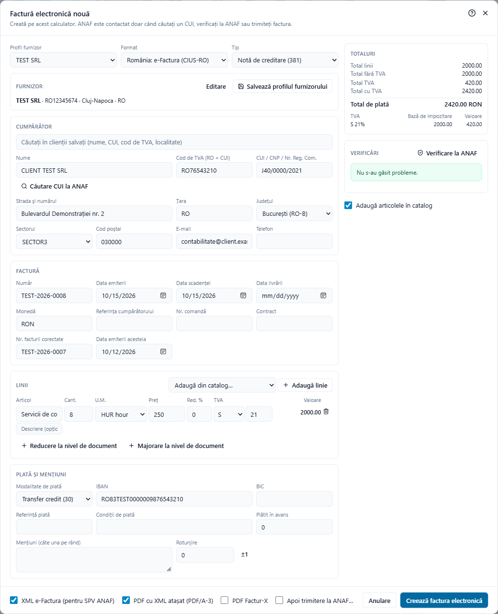

# Note de creditare

O notă de creditare anulează o factură, total sau parțial: mărfuri returnate, un preț redus după facturare, o factură emisă din greșeală. În e-Factura există două modalități acceptate, iar Adika le permite pe amândouă.

## Cele două modalități

**1. Notă de creditare (tipul 381).** Un document separat, de tip „notă de creditare”. Sumele lui se scriu ca numere **pozitive**: sunt sumele creditate. Face referire la factura pe care o corectează (câmpul e-Factura BT-25, „referința facturii anterioare”). Adika o scrie ca *CreditNote* UBL, așa cum așteaptă ANAF pentru tipul 381.

**2. Factură de stornare (tipul 380 cu cantități negative).** O factură obișnuită ale cărei linii au **cantități negative**, deci totalurile sunt negative. Multe programe de contabilitate din România lucrează așa. Și în acest caz este bine să indicați factura stornată.

Ambele sunt valabile în e-Factura. Întrebați-l pe contabilul dumneavoastră pe care o folosește firma și păstrați-o.

## Notă de creditare pentru una dintre facturile dumneavoastră

1. Deschideți factura pe care doriți să o creditați: XML-ul emis, arhiva ZIP descărcată din SPV sau PDF-ul cu XML-ul inclus (vedeți [Citirea unei e-Facturi primite](efactura-read.md)).
2. Faceți clic pe **Conversie → Factură electronică**.
3. Faceți clic pe **Creează notă de creditare**.

Se deschide fereastra **Factură electronică nouă**, deja completată:

- **Tip** este **Notă de creditare (381)**.
- **Nr. facturii corectate** și **Data emiterii acesteia** conțin numărul și data facturii originale (BT-25 și BT-26).
- Furnizorul, cumpărătorul și toate liniile sunt copiate din factură, cu aceleași cantități și prețuri, astfel încât nota de creditare o anulează integral.
- **Număr** este următorul număr din seria profilului de furnizor (dacă furnizorul este unul dintre profilurile salvate).
- Data scadenței este ziua de azi; condițiile de plată și mențiunile sunt golite.

Apoi ajustați-o:

- **Creditare parțială**: modificați cantitățile (de exemplu 2 din cele 10 bucăți returnate) sau prețurile (o reducere acordată ulterior) ori ștergeți liniile care nu se creditează.
- Adăugați o mențiune cu motivul, de exemplu „Retur marfă conform PV nr. 12”.

Verificați lista **Verificări**, alegeți fișierele din partea de jos (de obicei **XML e-Factura (pentru SPV ANAF)** și **PDF cu XML atașat (PDF/A-3)**) și faceți clic pe **Creează factura electronică**.

> Într-o notă de creditare (tipul 381) lăsați cantitățile și prețurile **pozitive**. O cantitate negativă într-o notă de creditare ar credita o sumă negativă, adică l-ar factura din nou pe client.

## Notă de creditare fără fișierul original

Dacă nu aveți fișierul facturii originale:

1. Faceți clic pe **Conversie → Factură electronică nouă**.
2. Alegeți **Tip → Notă de creditare (381)**.
3. Completați **Nr. facturii corectate** și **Data emiterii acesteia** pentru factura creditată. Dacă lăsați numărul gol, verificările arată un avertisment (BT-25: „Indicați numărul facturii care se corectează sau se stornează.”).
4. Adăugați liniile creditate, cu cantități și prețuri pozitive.

## Factură de stornare

1. Faceți clic pe **Conversie → Factură electronică nouă** și păstrați **Tip → Factură (380)**.
2. Adăugați liniile cu **cantitate negativă** (de exemplu `-2`). Prețul rămâne pozitiv; e-Factura nu permite prețuri negative (regula BR-27).
3. Indicați factura stornată: alegeți **Factură corectată (384)** dacă acesta este tipul cerut de contabil, iar câmpul **Nr. facturii corectate** apare, sau menționați factura la mențiuni.

## Notele de creditare și ANAF

Trimiteți o notă de creditare în SPV la fel ca o factură: vedeți [Trimiterea facturilor la ANAF](efactura-anaf-send.md). Adika recunoaște nota de creditare și folosește formatul ANAF pentru note de creditare atât la **Verificare la ANAF**, cât și la încărcare; nu trebuie să alegeți nimic.

## Note de creditare în alte formate

- **Peppol**: la fel, tipul 381, sume pozitive, referință la factură.
- **Factur-X**: tipul 381 în CII. Factur-X nu are un document separat pentru note de creditare; codul de tip o indică.

## Deschiderea unei note de creditare primite

O notă de creditare primită se deschide ca o factură (**Deschidere**, alegeți XML-ul sau arhiva ZIP). PDF-ul lizibil arată în titlu că este o notă de creditare, iar fereastra Factură electronică îi afișează datele. **Creează notă de creditare** aplicat pe o notă de creditare (sau pe o factură de stornare) produce un document care o anulează la rândul lui, cu semnele inversate.
