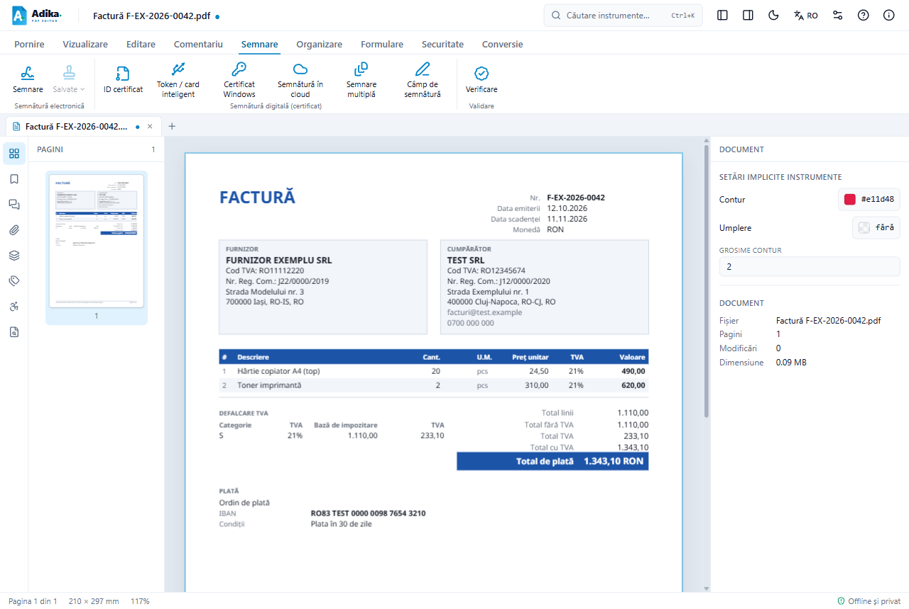
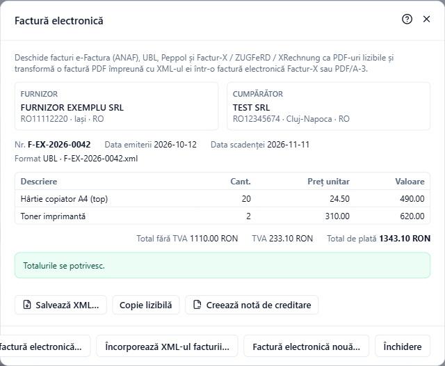

# Citirea unei e-Facturi primite

O e-Factură este un fișier XML: un format pentru calculatoare, greu de citit pe ecran. Adika îl transformă într-o factură obișnuită, ușor de citit, în format PDF și păstrează XML-ul original atașat în acel PDF.

Adika citește:

- facturi și note de creditare **e-Factura** (UBL 2.1 cu regulile românești CIUS-RO),
- **arhivele ZIP** descărcate din SPV-ul ANAF (XML-ul facturii plus fișierul de semnătură al ANAF),
- alte formate europene: **Peppol** (UBL), **XRechnung** și **Factur-X / ZUGFeRD** (CII).

## Deschiderea facturii

1. Faceți clic pe **Deschidere** în fila **Pornire** (sau apăsați **Ctrl+O**). Lista tipurilor de fișiere include XML și ZIP.
2. Alegeți fișierul `.xml` sau fișierul `.zip` exact așa cum l-ați descărcat din SPV. Nu trebuie să-l dezarhivați.

Puteți și să trageți fișierul în fereastra Adika sau să folosiți **Conversie → Factură electronică → Deschide XML factură electronică…**.

Factura se deschide într-o filă nouă, ca PDF ușor de citit:

Factura lizibilă arată furnizorul și cumpărătorul, numărul și datele facturii, toate liniile, defalcarea TVA pe cote, totalurile și datele de plată (IBAN, condiții). Etichetele sunt în limba interfeței: dacă doriți o copie în engleză, schimbați limba înainte de deschidere.

> PDF-ul lizibil este nou și încă nesalvat: fila afișează semnul ●. Apăsați **Salvare** pentru a-l păstra, de exemplu în dosarul contabilității. XML-ul original este inclus în PDF, așa că PDF-ul salvat este o înregistrare completă.

## Datele facturii și verificarea sumelor

Cu factura lizibilă deschisă (sau cu orice PDF care conține o factură, de exemplu un PDF Factur-X), faceți clic pe **Conversie → Factură electronică**:

Fereastra arată:

- **Furnizor** și **Cumpărător**, cu codurile de TVA, localitatea și țara,
- numărul, data emiterii, data scadenței și formatul (UBL sau CII), cu numele fișierului XML,
- liniile, cu cantități, prețuri unitare și valori,
- **Total fără TVA**, **TVA** și **Total de plată**.

Adika recalculează factura: fiecare linie (cantitate × preț), totalul liniilor, TVA-ul pe fiecare cotă, totalul cu TVA și totalul de plată. Când totul se potrivește, vedeți **Totalurile se potrivesc.** Când ceva nu se potrivește, o casetă galbenă arată exact ce, de exemplu că liniile însumează 1.110,00, iar factura indică 1.100,00. Aceeași listă apare și în secțiunea **Verificări** de la sfârșitul PDF-ului lizibil.

Se acceptă o diferență de rotunjire de un ban (0,01). Diferențele mai mari înseamnă de obicei că programul emitentului a calculat greșit: cereți furnizorului o factură corectată înainte de plată sau de înregistrare.

> **Semnătura ANAF.** Arhiva ZIP din SPV conține și un fișier de semnătură al ANAF (`semnatura_….xml`). Adika afișează factura, dar nu verifică această semnătură. Dacă aveți nevoie de dovada că fișierul provine din SPV, păstrați și arhiva ZIP originală.

## Butoanele ferestrei Factură electronică

- **Salvează XML…** salvează XML-ul facturii ca fișier separat (de exemplu pentru importul în programul de contabilitate).
- **Copie lizibilă** deschide un nou PDF lizibil al facturii, în limba curentă a interfeței.
- **Creează notă de creditare** pregătește o notă de creditare pentru această factură. Vedeți [Note de creditare](efactura-credit-notes.md).
- **Deschide XML factură electronică…** deschide alt fișier XML sau ZIP.
- **Încorporează XML-ul facturii…** atașează un XML de factură la PDF-ul deschis (vedeți mai jos).
- **Factură electronică nouă…** începe o factură nouă. Vedeți [Emiterea unei facturi](efactura-create.md).

## Unde este XML-ul în PDF?

Deschideți **Vizualizare → Atașamente** (sau agrafa din panoul din stânga). XML-ul facturii apare în listă; îl puteți salva și de acolo.

## Un singur fișier din factura PDF și XML-ul ei

Dacă aveți separat PDF-ul unei facturi și XML-ul ei (de exemplu din alt program), deschideți PDF-ul și folosiți **Conversie → Factură electronică → Încorporează XML-ul facturii…**. Alegeți fișierul XML:

- un XML **CII** produce o factură **Factur-X / ZUGFeRD** (formatul folosit în Franța și Germania),
- un XML **UBL** (e-Factura, Peppol) produce un fișier de arhivare **PDF/A-3** cu XML-ul încorporat.

Adika vă întreabă unde să salveze rezultatul (numele propus se termină în `-facturx` sau `-einvoice`) și apoi îl deschide. PDF-ul original nu se modifică.

## Clienții sunt reținuți

Când deschideți o factură emisă de **dumneavoastră** (furnizorul este unul dintre profilurile de furnizor salvate), cumpărătorul ei este adăugat în lista de clienți pentru facturile noi.

## Dacă apare o problemă

- „Acest fișier nu este o factură electronică (UBL, e-Factura sau CII).”: fișierul este alt tip de XML sau arhiva ZIP nu conține o factură (de exemplu un raport de erori de la ANAF). Vedeți [Probleme e-Factura](efactura-troubleshooting.md).
- Factura se deschide, dar arată probleme: citiți-le în caseta galbenă; ele provin din fișierul furnizorului, nu din Adika.
