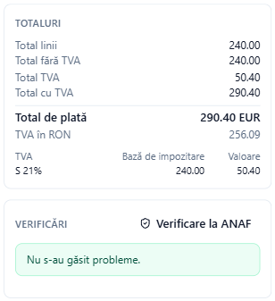

# TVA, monedă și plată

Această pagină explică părțile ferestrei **Factură electronică nouă** care cer puține cunoștințe fiscale: categoriile de TVA și motivele de scutire, reducerile și majorările, facturile în monedă străină și datele de plată. Pentru fereastra întreagă, vedeți [Emiterea unei facturi](efactura-create.md).

## Categoriile de TVA

Fiecare linie, precum și fiecare reducere sau majorare la nivel de document, are o categorie de **TVA** (literele) și o cotă (numărul):

| Cod | Semnificație | Când |
| --- | --- | --- |
| **S** | Cota standard | Vânzări obișnuite cu TVA; scrieți cota (de exemplu 21 sau 11) |
| **Z** | Cotă zero | Bunuri taxate cu 0 % |
| **E** | Scutit | Operațiuni scutite; trebuie să indicați motivul scutirii |
| **AE** | Taxare inversă | TVA-ul este datorat de cumpărător |
| **K** | Livrare intracomunitară | Vânzări către un cumpărător înregistrat în scopuri de TVA în alt stat UE |
| **G** | Export în afara UE | Bunuri care părăsesc UE |
| **O** | Neimpozabil (în afara sferei TVA) | Furnizori neînregistrați în scopuri de TVA |
| **L**, **M** | Insulele Canare, Ceuta și Melilla | Rar necesare în România |

Regulile pe care Adika le verifică pentru dumneavoastră:

- **S** cere o cotă mai mare decât 0 și codul de TVA al furnizorului.
- **AE** cere codul de TVA al furnizorului și codul de TVA sau numărul de înregistrare al cumpărătorului.
- **K** cere ambele coduri de TVA și **Data livrării**.
- **O** nu poate fi combinat cu alte categorii, iar factura nu mai poartă coduri de TVA.

Caseta **Totaluri** arată câte un rând pe categorie și cotă: baza de impozitare și TVA-ul.

## Motivele de scutire

Pentru **E**, **AE**, **K**, **G** și **O**, sub linii apare un rând cu două câmpuri: **Cod VATEX** și **Motivul scutirii**. e-Factura cere cel puțin unul dintre ele.

Adika completează valorile uzuale pentru e-Factura:

| Categorie | Cod VATEX | Motivul scris |
| --- | --- | --- |
| AE | VATEX-EU-AE | Taxare inversă |
| K | VATEX-EU-IC | Livrare intracomunitară scutită |
| G | VATEX-EU-G | Export scutit de TVA |
| O | VATEX-EU-O | Operațiune care nu intră în sfera de aplicare a TVA |

Pentru **E** (scutit) scrieți dumneavoastră motivul, de obicei temeiul legal (de exemplu articolul din Codul fiscal). Contabilul dumneavoastră știe formularea corectă.

## Reduceri și majorări

- **Red. %** pe o linie reduce acea linie cu un procent.
- **Reducere la nivel de document** reduce întreaga factură cu o sumă (de exemplu o reducere de fidelitate).
- **Majorare la nivel de document** adaugă o sumă la întreaga factură (de exemplu transport sau ambalare).

Fiecare reducere sau majorare la nivel de document are un **Motiv** și propria categorie și cotă de TVA, pentru că TVA-ul se calculează și asupra ei. O reducere fără motiv primește unul general și un avertisment (BR-33).

## Facturi în altă monedă

Când **Monedă** nu este RON (de exemplu EUR), o e-Factură trebuie să indice și totalul TVA în RON. Lângă monedă apare câmpul **RON pentru 1 EUR**:

1. Scrieți codul monedei la **Monedă** (trei litere: EUR, USD…).
2. Scrieți cursul de schimb la **RON pentru 1 EUR**, de obicei cursul BNR folosit de contabilul dumneavoastră.
3. Caseta **Totaluri** arată **TVA în RON** sub totalul de plată.

Fără curs, verificările arată **BR-RO-030** și factura nu poate fi emisă. Valorile liniilor rămân în moneda facturii.

## Plată și mențiuni

- **Modalitate de plată**: **Transfer credit (30)**, **Plată în cont bancar (42)**, **Transfer credit SEPA (58)**, **Numerar (10)**, **Card bancar (48)**, **Debitare directă (49)** sau **Nespecificat (1)**.
- **IBAN**: vi se oferă conturile salvate. Un transfer credit cere IBAN-ul; Adika îi verifică cifrele de control. **BIC** este opțional.
- **Referință plată**: ce trebuie să scrie clientul la plată (de exemplu numărul facturii).
- **Condiții de plată**: text liber, de exemplu „Plata în 30 de zile”. Când există o sumă de plată, factura are nevoie de **Data scadenței** sau de condiții de plată.
- **Plătit în avans**: o sumă deja plătită de client; se scade din totalul de plată.
- **Mențiuni (câte una pe rând)**: e-Factura permite cel mult 20 de mențiuni, fiecare de cel mult 300 de caractere.
- **Rotunjire**: o sumă adăugată la totalul de plată, pentru rotunjire; **±1** rotunjește totalul de plată la un leu întreg.

## Totalurile

Caseta **Totaluri** arată mereu, în această ordine: **Total linii**, reducerile și majorările, **Total fără TVA**, **Total TVA**, **Total cu TVA**, suma plătită în avans și rotunjirea și, la final, **Total de plată**. Adika rotunjește fiecare linie la două zecimale și calculează TVA-ul pe categorie și cotă, așa cum cere standardul european EN 16931; exact acest lucru îl verifică și ANAF.
