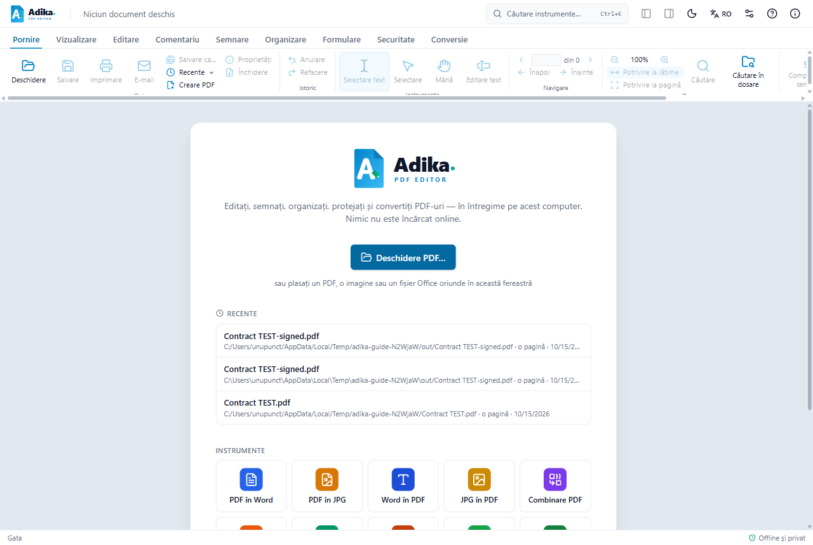
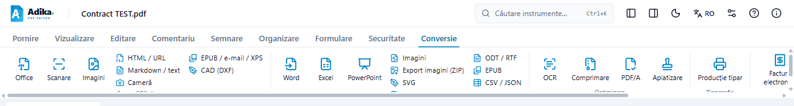

# Primii pași

Această pagină arată cum deschideți documente, cum vă orientați în fereastră, cum vă salvați munca și cum o recuperați după o închidere neașteptată.

## Deschiderea unui document

- Faceți clic pe **Deschidere** în fila **Pornire** sau apăsați **Ctrl+O** și alegeți fișierul.
- Sau trageți un fișier din File Explorer oriunde în fereastra Adika.
- **Recente** (în fila Pornire) arată fișierele deschise în ultima vreme.

Adika deschide fișiere PDF, imagini (JPG, PNG, HEIC, TIFF…), documente Office (Word, Excel, PowerPoint, dacă Microsoft Office este instalat) și facturi electronice (fișiere XML e-Factura și arhivele ZIP descărcate din SPV-ul ANAF). Imaginile, documentele Office și facturile sunt transformate în PDF la deschidere; fișierul original nu se modifică.

Dacă un PDF este protejat cu parolă, Adika v-o cere.

## Panglica pe scurt

Comenzile sunt grupate în file, în partea de sus a ferestrei:

| Filă | Ce găsiți acolo |
| --- | --- |
| **Pornire** | Deschidere, Salvare, Imprimare, E-mail, Anulare / Refacere, selectarea textului, zoom, Căutare, Completare și semnare |
| **Vizualizare** | Aranjarea paginilor, rotirea afișării, modul de citire, citirea cu voce tare, panourile laterale (pagini, marcaje, atașamente, comentarii) |
| **Editare** | Editarea textului, adăugarea de text, imagini, legături, antete și subsoluri, forme desenate |
| **Comentariu** | Note, evidențiere, ștampile, desene, lista comentariilor |
| **Semnare** | Semnătura olografă (Completare și semnare), semnături digitale cu certificat, token, certificat Windows sau semnătură în cloud, **Semnare multiplă**, **Verificare** |
| **Organizare** | Pagini: inserare, ștergere, mutare, rotire, împărțire, combinarea fișierelor |
| **Formulare** | Câmpuri de formular, completare, detectarea câmpurilor |
| **Securitate** | Parole, permisiuni, anonimizare (înnegrire), eliminarea informațiilor ascunse, accesibilitate |
| **Conversie** | PDF în Word, Excel, imagini; PDF/A; OCR; comprimare; **Factură electronică**, **Factură electronică nouă**, **ANAF e-Factura** |

Nu știți unde se află o comandă? Faceți clic pe **Căutare instrumente…** în partea de sus a ferestrei (sau apăsați **Ctrl+K**) și scrieți ce doriți să faceți, de exemplu „factură” sau „semnare”.

Majoritatea butoanelor afișează o scurtă explicație când țineți mouse-ul deasupra lor. Apăsați **Alt** pentru a ajunge la panglică de la tastatură, apoi folosiți săgețile și Enter.

## Salvarea

- **Salvare** (Ctrl+S) scrie modificările în fișierul deschis.
- **Salvare ca…** (Ctrl+Shift+S) scrie o copie cu un nume nou și lasă originalul neschimbat.
- Un punct (●) lângă numele fișierului înseamnă că există modificări nesalvate.

Documentele provenite dintr-o factură, o imagine sau un fișier Office nu au încă un PDF pe disc: prima salvare vă întreabă unde să pună noul PDF.

> **Documente semnate.** Când salvați un PDF care are semnături digitale, Adika adaugă modificările la sfârșitul fișierului (o „actualizare incrementală”), astfel încât semnăturile rămân valide. Unele modificări nu pot fi adăugate astfel; atunci Adika vă avertizează înainte de salvare. Vedeți [Probleme la semnare](signing-troubleshooting.md#salvarea-va-invalida-semnăturile).

## Anulare și refacere

- **Anulare** (Ctrl+Z) retrage ultima modificare; apăsați din nou pentru a merge mai departe înapoi.
- **Refacere** (Ctrl+Y) readuce o modificare.

Anularea funcționează pentru editări, comentarii, modificări de pagini, căutare și înlocuire și anonimizare, până la închiderea documentului.

## Mai multe documente: filele

Fiecare document se deschide în propria filă, sub panglică.

- Faceți clic pe o filă pentru a trece la ea sau apăsați **Ctrl+Tab** (și **Ctrl+Shift+Tab** pentru a reveni).
- **Ctrl+W** închide documentul curent. Adika vă întreabă mai întâi dacă are modificări nesalvate.
- Butonul **+** de lângă file deschide alt fișier.
- Trageți o filă în afara ferestrei pentru a deschide documentul într-o fereastră separată.

## După o închidere neașteptată

Adika păstrează automat o copie de siguranță a fiecărui document cu modificări nesalvate, la câteva secunde după fiecare modificare. Dacă Adika sau Windows se oprește neașteptat, la următoarea pornire fereastra **Recuperare documente nesalvate** arată aceste documente și ora ultimei copii.

1. Bifați documentele pe care le doriți înapoi.
2. Faceți clic pe **Recuperare**. Ele se deschid așa cum erau la ultima copie.
3. Salvați-le (cel mai sigur cu Salvare ca…).

**Renunțare** șterge copiile de siguranță. Când închideți Adika normal, copiile sale sunt eliminate.

## Limba și aspectul

- **Butonul de limbă** din dreapta sus (afișează limba curentă, de exemplu **RO**) schimbă interfața între English, Română, Deutsch, Français, Magyar, Italiano și Español. Acest ghid există în engleză și română; pentru celelalte limbi este afișat în engleză.
- Butonul **lună / soare** comută între modul luminos și cel întunecat.
- Butonul **i** (Despre) arată versiunea, comenzile rapide de la tastatură, actualizările și opțiunile de salvare.

## Pașii următori

- [Citirea unei e-Facturi primite](efactura-read.md)
- [Emiterea unei facturi](efactura-create.md)
- [Semnarea unui document](signing-sign.md)
