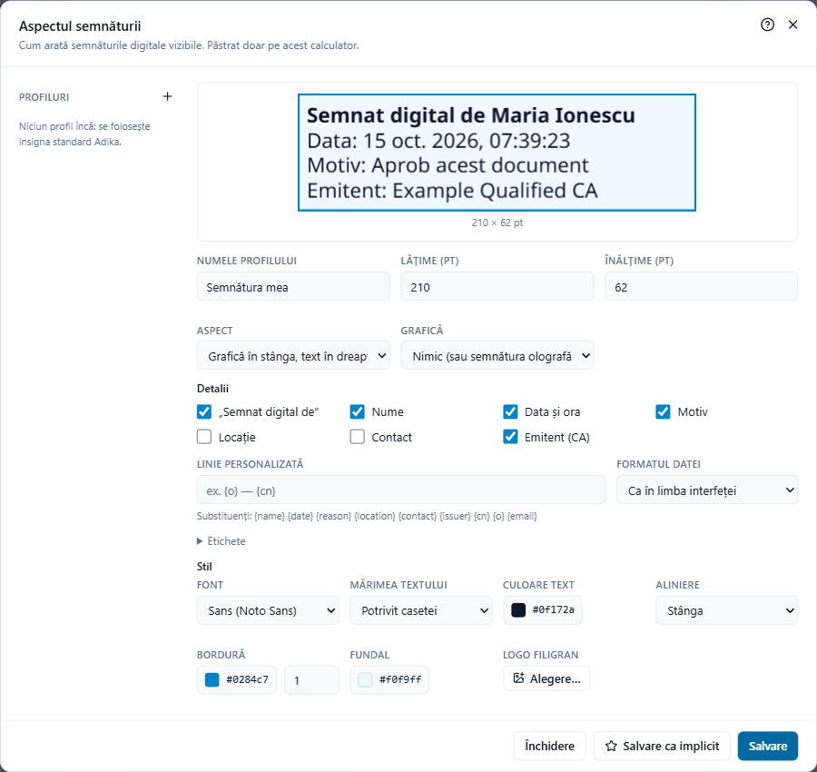

# Semnături vizibile și proiectarea aspectului

O semnătură digitală poate fi **vizibilă** (o casetă pe pagină cu numele, data și, dacă doriți, semnătura olografă sau sigla) sau **invizibilă** (nimic pe pagină; semnătura apare în panoul de semnături și la **Verificare**). Ambele sunt la fel de valabile. Semnăturile vizibile sunt mai ușor de înțeles pentru cei care tipăresc documentul.

## Unde apare semnătura

În fiecare fereastră de semnare, **Semnătură vizibilă** oferă:

- **Colțul din dreapta jos**, **Colțul din stânga jos**, **Colțul din dreapta sus**, **Colțul din stânga sus** al paginii alese la **Pagina**. Caseta are 210 × 62 de puncte (aproximativ 7,4 × 2,2 cm), la 28 de puncte de margini.
- **Pe semnătura olografă selectată**: dacă ați plasat semnătura de mână cu **Completare și semnare** și ați selectat-o, semnătura digitală îi ia locul și dimensiunea; scrisul dumneavoastră devine imaginea semnăturii digitale.
- **În câmpul de semnătură selectat**: când este selectat un câmp de semnătură desenat de dumneavoastră (vedeți mai jos).
- **Invizibilă (fără ecuson vizibil)**.

Pentru a pune semnătura într-un loc exact, plasați mai întâi acolo semnătura olografă (sau desenați acolo un câmp de semnătură), selectați-o, apoi deschideți fereastra de semnare.

## Câmpurile de semnătură

Un câmp de semnătură este o casetă goală în care urmează să semneze cineva, de exemplu pe un contract pe care îl trimiteți.

**Adăugarea unui câmp:** faceți clic pe **Semnare → Câmp de semnătură**, apoi trageți un dreptunghi pe pagină. Salvați documentul și trimiteți-l. Destinatarul semnează în acea casetă cu propriul program.

**Semnarea într-un câmp desenat în Adika:** faceți clic pe câmp cu instrumentul **Selectare**, ca să fie selectat, deschideți fereastra de semnare și păstrați **În câmpul de semnătură selectat**.

**Semnarea într-un câmp gol al unui PDF primit:** folosiți **Semnare → Semnare multiplă** doar cu acel fișier și bifați **Semnare în câmpul de semnătură gol, dacă fișierul are unul cu numele:** cu numele câmpului (adesea `Signature1`; întrebați expeditorul dacă nu sunteți sigur). Vedeți [Semnarea mai multor fișiere](signing-batch.md). În ferestrele pentru un singur document, plasați semnătura peste câmp folosind un colț sau o semnătură olografă.

## Alegerea aspectului

Sub **Semnătură vizibilă**, **Aspect** oferă:

- **Insignă standard**: caseta Adika cu „Semnat digital de”, numele, data, motivul și emitentul.
- propriile **profiluri**, create în editorul de aspect; profilul implicit este marcat cu ★.

## Editorul de aspect

Faceți clic pe **Proiectare aspect…** în oricare fereastră de semnare.

Previzualizarea din partea de sus arată caseta cu valori de exemplu și se schimbă pe măsură ce editați. În stânga, **Profiluri** arată modelele salvate (**+** creează unul nou; țineți mouse-ul pe un profil pentru a-l duplica sau șterge).

**Dimensiune și așezare**

- **Numele profilului**, **Lățime (pt)** și **Înălțime (pt)** (72 de puncte = 2,54 cm). Când semnați pe o semnătură olografă sau într-un câmp, caseta preia dimensiunea acestora.
- **Aspect**: **Grafică în stânga, text în dreapta**, **Grafică sus, text dedesubt**, **Doar text**, **Doar grafică**.

**Grafică**

- **Nimic (sau semnătura olografă pe care semnezi)**.
- **Semnătură olografă sau logo**: una dintre semnăturile salvate sau **Fișier imagine…** (PNG, JPEG).
- **Numele meu într-un font de mână**: numele scris cu un font de tip scris de mână instalat în Windows, în culoarea aleasă.

**Detalii**: bifați ce arată textul: „Semnat digital de”, **Nume**, **Data și ora**, **Motiv**, **Locație**, **Contact**, **Emitent (CA)**.

- **Linie personalizată**: un text propriu, cu substituenți completați la semnare: `{name}` `{date}` `{reason}` `{location}` `{contact}` `{issuer}` `{cn}` `{o}` `{email}`. De exemplu `{o} — {cn}` dă organizația și numele din certificat.
- **Formatul datei**: ca în limba interfeței sau unul dintre formatele fixe.
- **Etichete**: schimbați cuvintele din fața valorilor.

**Stil**: **Font**, **Mărimea textului** (**Potrivit casetei** micșorează textul ca să încapă), **Culoare text**, **Aliniere**, **Bordură** (culoare și grosime sau fără), **Fundal** și un **Logo filigran**, cu opacitatea lui, în spatele textului.

Faceți clic pe **Salvare** pentru a păstra profilul sau pe **Salvare ca implicit** pentru a-l folosi automat de acum înainte. Profilurile sunt păstrate doar pe acest calculator.

## Ce ajunge în PDF

Caseta vizibilă este desenată cu text real (poate fi selectat și căutat), drept chiar și pe paginile rotite. Numele, emitentul și data sunt preluate din certificat și din momentul semnării; ceea ce dovedește semnătura este certificatul, nu imaginea.

Mai departe: [Semnarea mai multor fișiere](signing-batch.md)
