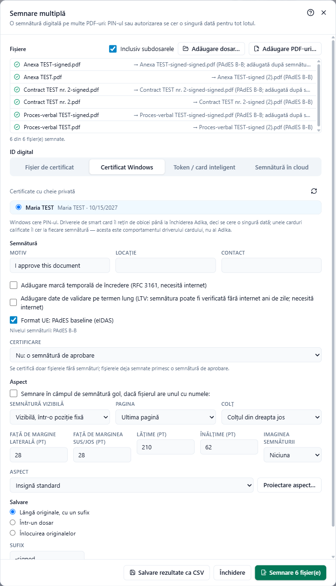

# Semnarea mai multor fișiere deodată

**Semnare → Semnare multiplă** aplică aceeași semnătură digitală pe multe PDF-uri dintr-o dată: un dosar de contracte, facturile lunii, un set de rapoarte. Introduceți PIN-ul sau parola **o singură dată** pentru tot lotul. Nu trebuie să aveți niciun document deschis.

## 1. Alegerea fișierelor

- **Adăugare dosar…** adaugă toate PDF-urile dintr-un dosar; bifați **Inclusiv subdosarele** pentru a include și dosarele din interiorul lui.
- **Adăugare PDF-uri…** adaugă fișiere individuale. Puteți adăuga din mai multe locuri.
- Coșul de gunoi de lângă un fișier îl scoate din listă.

## 2. Alegerea ID-ului digital

Filele **ID digital** corespund acelorași patru locuri ca pentru un singur document (vedeți [Semnarea unui document](signing-sign.md)):

- **Fișier de certificat**: alegeți fișierul .pfx / .p12, introduceți parola, **Deblocare**. Parola este păstrată doar cât timp fereastra este deschisă.
- **Certificat Windows**: alegeți certificatul. Windows cere PIN-ul. Majoritatea driverelor de card îl rețin până la închiderea Adika, deci îl introduceți o singură dată; unele carduri calificate îl cer la fiecare semnătură. Aceasta este regula driverului cardului, nu a Adika.
- **Token / card inteligent**: alegeți driverul și certificatul și introduceți **PIN token**. Adika se autentifică o singură dată pe token pentru tot lotul și se deconectează la final. Unele chei calificate cer PIN-ul pentru fiecare semnătură în parte; atunci Adika îl transmite tokenului de fiecare dată, până la terminarea lotului. PIN-ul nu se stochează niciodată.
- **Semnătură în cloud**: furnizorul trebuie să fie deja adăugat în **Semnare → Semnătură în cloud**. Autentificați-vă, alegeți certificatul, introduceți PIN-ul și codul unic. O autorizare acoperă mai multe fișiere; dacă furnizorul permite doar un număr limitat de semnături pe autorizare, Adika vă cere un nou cod unic pentru următorul grup de fișiere.

## 3. Opțiunile semnăturii

**Motiv**, **Locație**, **Contact**, marca temporală de încredere, validarea pe termen lung, marca temporală de arhivare și **Format UE: PAdES baseline (eIDAS)** funcționează ca pentru un singur document; nivelul este afișat sub ele. Vedeți [Semnăturile pe înțelesul tuturor](signing-concepts.md#nivelurile-pades).

**Certificare**: doar fișierele fără semnături sunt certificate; fișierele deja semnate primesc o semnătură de aprobare.

## 4. Aspectul

- **Semnare în câmpul de semnătură gol, dacă fișierul are unul cu numele:** scrieți numele câmpului (de exemplu `Signature1`). Fișierele care au un câmp gol cu acest nume sunt semnate în câmp; celelalte primesc semnătura stabilită mai jos (**Altfel**).
- **Semnătură vizibilă**: **Vizibilă, într-o poziție fixă** sau **Invizibilă (fără ecuson vizibil)**.
- **Pagina**: **Prima pagină**, **Ultima pagină** sau **Număr pagină**.
- **Colț**, apoi **Față de margine laterală (pt)** și **Față de marginea sus/jos (pt)**: distanța față de colț. **Lățime (pt)** și **Înălțime (pt)**: dimensiunea casetei (72 pt = 2,54 cm).
- **Imaginea semnăturii**: una dintre semnăturile olografe salvate sau **Niciuna**.
- **Aspect**: insigna standard sau unul dintre profilurile dumneavoastră; **Proiectare aspect…** deschide editorul (vedeți [Semnături vizibile](signing-appearance.md)).

## 5. Unde ajung fișierele semnate

La **Salvare**:

- **Lângă originale, cu un sufix**: `contract.pdf` devine `contract-signed.pdf` în același dosar. Puteți schimba **Sufix**.
- **Într-un dosar**: faceți clic pe **Alegere…**; fișierele semnate își păstrează numele (acolo sufixul poate fi gol).
- **Înlocuirea originalelor**: Adika cere confirmarea. Fiecare original este înlocuit doar după ce versiunea lui semnată este completă; fișierele care eșuează sau sunt sărite rămân neschimbate.

Fișierele existente nu sunt niciodată suprascrise: la nume se adaugă un număr.

## 6. Semnarea

Faceți clic pe **Semnare N fișier(e)**. În timpul rulării, lista arată rezultatul fiecărui fișier, iar **Oprire după acest fișier** încheie lotul după fișierul curent.

La final:

- fișierele reușite (✓) arată numele copiei semnate și nivelul semnăturii,
- fișierele sărite sau eșuate arată motivul,
- rezumatul spune, de exemplu, **3 din 3 fișier(e) semnate.**

**Salvare rezultate ca CSV** salvează lista (fișier, stare, rezultat, detalii) pentru evidența dumneavoastră; se deschide în Excel.

## Fișiere sărite

| Motivul afișat | De ce |
| --- | --- |
| protejat cu parolă: deschideți-l, eliminați parola și semnați-l separat | PDF-urile criptate nu se semnează în lot. |
| certificat cu „nicio modificare permisă”: o altă semnătură l-ar invalida | Documentul a fost certificat fără drept de modificare. |
| fișierul nu are pagina N | Ați ales un număr de pagină pe care fișierul nu îl are. |
| nu există câmpul gol „…” (o notă) | Fișierul nu avea un câmp gol cu acel nume; a fost semnat în poziția fixă. |
| nesemnat: semnarea s-a oprit după eroarea de mai sus | ID-ul digital a dat o eroare (PIN greșit, token scos, eroare la furnizor). Adika se oprește la prima astfel de eroare, ca să nu încerce iar și iar un token care se poate bloca. Remediați cauza și semnați fișierele rămase. |

## Pentru IT: linia de comandă

Administratorii pot semna din scripturi, fără a deschide fereastra: `adika-pdf-editor.exe --batch --sign …` cu un fișier .pfx (`--pfx`, parola în variabila de mediu `ADIKA_PFX_PASSWORD`) sau cu un certificat Windows (`--thumbprint`). Rulați `adika-pdf-editor.exe --batch --help` pentru lista completă de opțiuni.
