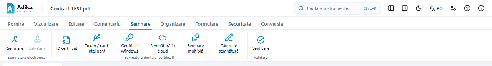
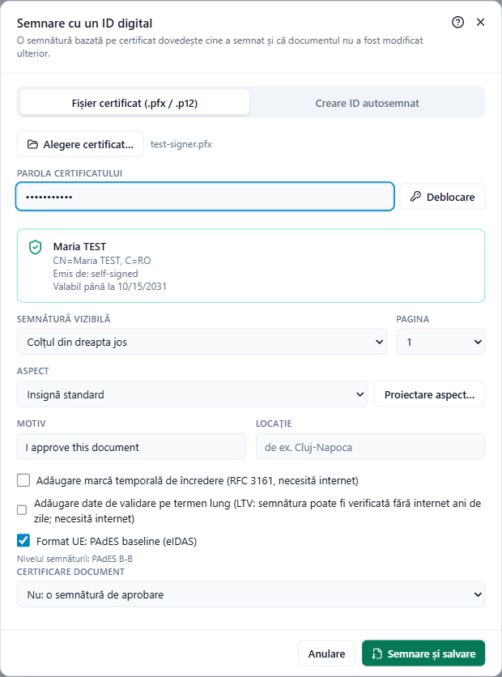
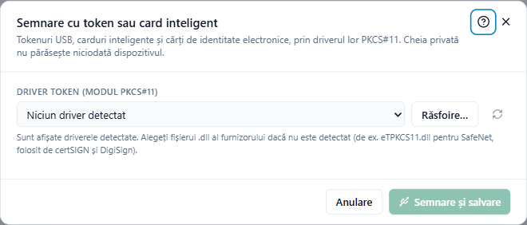
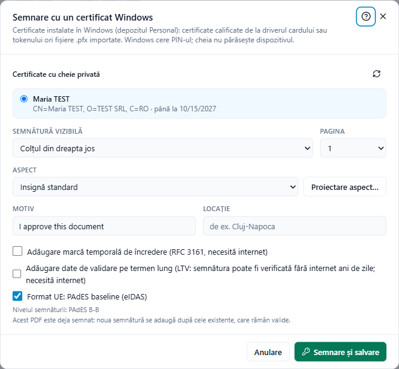
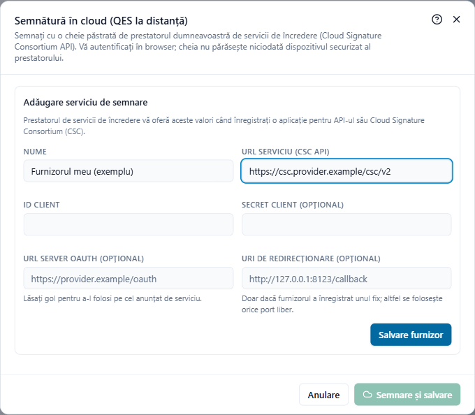

# Semnarea unui document

Deschideți PDF-ul și faceți clic pe fila **Semnare**. Grupul **Semnătură digitală (certificat)** are câte un buton pentru fiecare loc în care se poate afla certificatul dumneavoastră:

- **ID certificat**: un fișier .pfx / .p12 sau un ID autosemnat nou.
- **Token / card inteligent**: un token USB sau un card, prin driverul lui (PKCS#11).
- **Certificat Windows**: un certificat instalat în Windows.
- **Semnătură în cloud**: o semnătură calificată la distanță, la furnizorul dumneavoastră.

Nu știți pe care îl aveți? Un certificat calificat pe token funcționează de obicei atât ca **Token / card inteligent**, cât și ca **Certificat Windows** (dacă programul furnizorului este instalat). **Certificat Windows** este cel mai simplu de încercat mai întâi.

## Înainte de semnare

- Terminați modificările. Adika semnează documentul așa cum apare pe ecran și salvează rezultatul ca **fișier nou** (propune numele cu `-signed` la sfârșit, apoi îl deschide). Fișierul deschis inițial nu se modifică.
- Un document deja semnat poate fi semnat din nou; semnăturile anterioare rămân valide. Salvați sau anulați mai întâi celelalte modificări: Adika refuză să adauge o semnătură peste modificări nesalvate ale unui PDF semnat, pentru că acele modificări ar invalida semnăturile anterioare.

## Semnarea cu un fișier de certificat (.pfx sau .p12)

1. Faceți clic pe **Semnare → ID certificat**.
2. În fila **Fișier certificat (.pfx / .p12)**, faceți clic pe **Alegere certificat…** și alegeți fișierul.
3. Introduceți **Parola certificatului** și faceți clic pe **Deblocare** (sau apăsați Enter). O fișă arată titularul, emitentul și data de expirare.
4. Alegeți unde apare semnătura și opțiunile (vedeți [Opțiunile comune](#opțiunile-comune)).
5. Faceți clic pe **Semnare și salvare**.

**Creare ID autosemnat** produce pe loc un certificat cu numele introdus. El dovedește că documentul nu a fost modificat după semnare, dar nu și *cine* a semnat: cititorii văd „autosemnat, neverificat”. Folosiți-l pentru teste sau documente interne; **Salvare ID ca .p12** îl păstrează pentru mai târziu.

## Semnarea cu un token USB sau un card inteligent

1. Conectați tokenul sau introduceți cardul.
2. Faceți clic pe **Semnare → Token / card inteligent**.
3. **Driver token (modul PKCS#11)**: Adika afișează driverele găsite. Dacă al dumneavoastră lipsește, faceți clic pe **Răsfoire…** și alegeți fișierul `.dll` al producătorului (de exemplu `eTPKCS11.dll` pentru tokenurile SafeNet, folosite de certSIGN și DigiSign). Ghidul de instalare al furnizorului indică fișierul.
4. Apar tokenurile și certificatele lor; alegeți certificatul.
5. Introduceți **PIN token**. Este folosit doar pentru această semnătură și nu se stochează niciodată. Dacă cititorul de carduri are tastatură proprie, introduceți PIN-ul acolo.
6. Alegeți opțiunile și faceți clic pe **Semnare și salvare**.

> Tokenurile se blochează după câteva PIN-uri greșite (adesea 3). Dacă Adika spune că PIN-ul este greșit, verificați limba tastaturii și Caps Lock înainte de a încerca din nou.

## Semnarea cu un certificat instalat în Windows

Certificatele calificate de pe tokenuri și carduri apar de obicei în Windows după instalarea programului furnizorului. Și un fișier .pfx poate fi instalat în Windows (dublu clic pe el).

1. Faceți clic pe **Semnare → Certificat Windows**.
2. Alegeți un certificat din **Certificate cu cheie privată**. Certificatele calificate sunt marcate **Calificat** sau **Calificat (QSCD)**; cele expirate, **Expirat**.
3. Alegeți opțiunile și faceți clic pe **Semnare și salvare**. **Windows** vă cere PIN-ul, într-o fereastră proprie.

## Semnarea cu o semnătură în cloud

Semnăturile în cloud (la distanță) folosesc **API-ul Cloud Signature Consortium (CSC)**, un standard oferit de mulți furnizori europeni. Certificatul rămâne la furnizor.

**Ce cereți furnizorului** (o singură dată):

- **adresa serviciului** (URL-ul API-ului CSC, se termină adesea în `/csc/v2` sau `/csc/v1`),
- un **Client ID** (și un **Client Secret**, dacă îl folosesc) pentru o aplicație desktop,
- dacă au nevoie de o **adresă de redirecționare** fixă; în acest caz folosiți una de forma `http://127.0.0.1:8123/callback` și comunicați-le-o,
- dacă semnăturile se confirmă cu PIN, cu un cod unic (SMS / aplicație) sau în browser.

**Adăugarea furnizorului:** faceți clic pe **Semnare → Semnătură în cloud**. Prima dată se deschide formularul **Adăugare serviciu de semnare**: completați **Nume**, **URL serviciu (CSC API)**, **ID client** și, dacă le-ați primit, celelalte câmpuri; faceți clic pe **Salvare furnizor**.

**Semnarea:**

1. Alegeți **Serviciu de semnare** și faceți clic pe **Autentificare**. Browserul deschide pagina de autentificare a furnizorului; autentificați-vă acolo.
2. Înapoi în Adika, apar certificatele de semnare. Alegeți unul.
3. Dacă vi se cere, introduceți **PIN** și **Cod unic** (apăsați **Trimitere cod** pentru a-l primi prin SMS, e-mail sau aplicație). Unii furnizori vă cer în schimb să confirmați fiecare semnătură în browser.
4. Alegeți opțiunile și faceți clic pe **Semnare și salvare**.

PIN-ul și codul sunt trimise doar furnizorului și nu se stochează niciodată. Rămâneți autentificat până la închiderea Adika sau până apăsați **Deconectare**.

> **Atenție.** Semnarea în cloud a fost testată cu un serviciu CSC simulat, nu încă cu toți furnizorii. Dacă serviciul furnizorului dumneavoastră nu funcționează cu Adika, vă rugăm să ne semnalați.

## Opțiunile comune

Toate ferestrele de semnare se încheie cu aceleași opțiuni:

- **Semnătură vizibilă**: **Colțul din dreapta jos** (și celelalte colțuri) ale paginii alese la **Pagina**, **Pe semnătura olografă selectată** / **În câmpul de semnătură selectat** când pe pagină este selectat unul dintre ele, sau **Invizibilă (fără ecuson vizibil)**. Vedeți [Semnături vizibile](signing-appearance.md).
- **Aspect**: cum arată semnătura vizibilă; **Proiectare aspect…** deschide editorul de aspect.
- **Motiv** (implicit „Aprob acest document”) și **Locație**.
- **Adăugare marcă temporală de încredere (RFC 3161, necesită internet)** și **URL autoritate de marcare temporală**: serverul de marcare temporală al furnizorului dumneavoastră sau cel implicit.
- **Adăugare date de validare pe termen lung (LTV…)** și **Adăugare marcă temporală de arhivare…**.
- **Format UE: PAdES baseline (eIDAS)**: rândul de sub opțiune arată nivelul (B-B, B-T, B-LT, B-LTA). Vedeți [Semnăturile pe înțelesul tuturor](signing-concepts.md#nivelurile-pades).
- **Certificare document**: doar pentru prima semnătură. Vedeți [Semnături de aprobare și de certificare](signing-concepts.md#semnături-de-aprobare-și-de-certificare).

## După semnare

Copia semnată se deschide. Faceți clic pe **Semnare → Verificare** pentru a vedea semnătura așa cum o vor vedea ceilalți: vedeți [Verificarea semnăturilor](signing-verify.md). Dacă ceva nu a mers, vedeți [Probleme la semnare](signing-troubleshooting.md).
