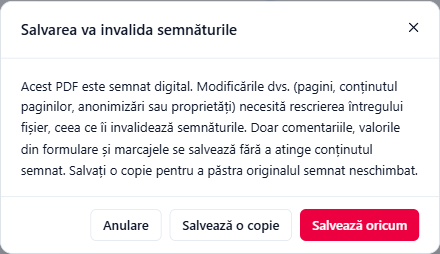

# Probleme la semnare

## PIN și parolă

- **„PIN incorect. Atenție: tokenurile se blochează după câteva încercări greșite.”** Verificați Caps Lock și limba tastaturii (tastatura română și cea engleză au unele caractere în locuri diferite). Majoritatea tokenurilor se blochează după 3 PIN-uri greșite.
- **„PIN-ul tokenului este blocat. Deblocați-l cu aplicația furnizorului (PUK).”** Folosiți programul tokenului oferit de furnizor (de exemplu SafeNet Authentication Client) împreună cu codul PUK sau contactați furnizorul.
- **„Parolă greșită pentru acest fișier de certificat.”** Parola fișierului .pfx / .p12 este greșită. Este parola aleasă la exportul fișierului, nu parola Windows.
- **Windows cere PIN-ul la fiecare semnătură.** Așa sunt configurate unele carduri calificate (driverul, nu Adika). Cu **Semnare multiplă** și **Token / card inteligent**, Adika transmite PIN-ul în locul dumneavoastră pe durata lotului.

## Tokenul sau cardul nu este găsit

- **„Niciun driver detectat”** sau **„Nu s-a găsit niciun token. Introduceți tokenul sau cardul și apăsați Reîmprospătare.”** Conectați tokenul, așteptați ca Windows să-l recunoască, apoi faceți clic pe butonul de reîmprospătare. Instalați programul tokenului de la furnizor, dacă nu l-ați instalat.
- **Driverul nu apare în listă.** Faceți clic pe **Răsfoire…** și alegeți fișierul `.dll` PKCS#11 indicat în ghidul furnizorului (de exemplu `eTPKCS11.dll` pentru tokenurile SafeNet, de obicei în `C:\Windows\System32`).
- **„Could not load …”** Adika este un program pe 64 de biți și are nevoie de driverul pe **64 de biți**. Fișierele din `C:\Windows\SysWOW64` sau din `Program Files (x86)` sunt de obicei pe 32 de biți.
- **„Niciun certificat vizibil pe acest token.”** Certificatul poate fi pe alt slot al cardului sau tokenul este gol. Încercați în schimb **Certificat Windows**.
- **Lista certificatelor Windows este goală.** Mesajul spune: „Nu este instalat niciun certificat cu cheie privată.” Instalați programul tokenului sau al cardului (el copiază certificatul în Windows) sau faceți dublu clic pe fișierul .pfx pentru a-l instala.
- **„Certificatul folosește un tip de cheie neacceptat.”** Adika semnează doar cu chei RSA și ECDSA.

## Semnătura apare portocalie sau roșie la Verificare

- **Autosemnat — neverificat**: certificatul a fost creat chiar de titular (de exemplu cu **Creare ID autosemnat**). Normal pentru teste; nu dovedește identitatea.
- **Nu este de încredere pe acest computer** sau **Lanț incomplet**: Windows nu cunoaște certificatul rădăcină al emitentului. Pentru certificatele calificate din UE, faceți clic pe **Descărcare** în bara listelor de încredere UE din fereastra de verificare, apoi pe **Reverificare**. Pentru alți emitenți, instalați certificatul rădăcină al emitentului în Windows, dacă aveți încredere în el (întrebați departamentul IT).
- **Certificatul nu este valabil la momentul validării**: certificatul expirase (sau nu era încă valabil) în momentul verificării. O semnătură cu **marcă temporală de încredere**, făcută cât timp certificatul era valabil, rămâne validă și după expirarea certificatului; fără marcă temporală, verificarea folosește ora curentă.
- **REVOCAT**: emitentul a retras certificatul. Semnăturii nu i se poate acorda încredere.
- **MODIFICAT — semnătură invalidă** sau **Nu — conținutul a fost modificat după această semnătură**: vedeți [Verificarea semnăturilor](signing-verify.md#rândurile-fișei).

## Certificat expirat

Fișa din fereastra de semnare arată **Expirat** cu roșu. Semnăturile făcute cu el vor apărea ca nevalabile. Reînnoiți certificatul la furnizor. Semnăturile făcute **înainte** de expirare rămân valide; cele cu marcă temporală de încredere sau cu validare pe termen lung pot fi verificate și peste mulți ani.

## Marca temporală și validarea pe termen lung

- **„Serverul de marcă temporală … a răspuns HTTP …”** sau o eroare de rețea: serverul de marcare temporală nu poate fi contactat. Verificați conexiunea la internet, încercați mai târziu sau folosiți serverul de marcare temporală al furnizorului la **URL autoritate de marcare temporală**. Unele birouri au nevoie de un proxy; întrebați departamentul IT.
- **„Serverul de marcă temporală a respins cererea”**: unele servere cer un cont. Folosiți serverul oferit de furnizorul dumneavoastră.
- **„Semnat. Validarea pe termen lung este incompletă: …”** Documentul este semnat; doar o parte din datele de validare nu au putut fi obținute (de exemplu serverul de revocare al unui emitent nu a răspuns). Le puteți adăuga mai târziu cu **Verificare → Adăugare validare pe termen lung**.
- **„Marcarea temporală este dezactivată de organizația dumneavoastră.”** / **„Verificarea online a certificatelor este dezactivată de organizația dumneavoastră.”** Funcțiile online sunt dezactivate prin politică; opțiunile apar inactive.

## Salvarea va invalida semnăturile

Când modificați un PDF semnat și îl salvați, Adika adaugă de obicei modificările la sfârșitul fișierului (o actualizare incrementală), astfel încât semnăturile rămân valide. Aceasta funcționează pentru **comentarii**, **valori din formulare** și **marcaje**.

Modificările de **pagini** (adăugare, ștergere, mutare, rotire), de **conținut al paginii** (text, imagini, desene), **anonimizările** sau modificările **proprietăților documentului** cer rescrierea întregului fișier. Atunci Adika întreabă mai întâi:

- **Salvează o copie** păstrează originalul semnat și salvează versiunea modificată ca fișier nou. De obicei aceasta este alegerea potrivită.
- **Salvează oricum** suprascrie fișierul; semnăturile lui vor apărea ca invalide.
- **Anulare** nu salvează nimic.

Dacă doriți să semnați **după** modificări, salvați mai întâi o copie, apoi semnați copia.

De asemenea: **„Acest PDF are deja semnături digitale și modificări nesalvate.”** Adika nu adaugă o semnătură peste modificări nesalvate ale unui PDF semnat. Salvați o copie (sau anulați modificările), apoi semnați.

## Regulile organizației

- **„Organizația dumneavoastră nu permite semnarea cu certificate de la acest emitent: …”** Departamentul IT permite doar certificate de la anumiți emitenți. Folosiți un certificat de la unul dintre ei.
- **„Semnarea la distanță (în cloud) este dezactivată de organizația dumneavoastră.”** Semnăturile în cloud sunt dezactivate prin politică.

## Semnătura în cloud

- **„Acest cont nu are certificate de semnare.”** V-ați autentificat cu un cont care nu are certificat la furnizor sau certificatul nu este încă activat.
- Un certificat marcat **Expirat**, **Cheie dezactivată** sau **Tip de cheie neacceptat** nu poate fi folosit; contactați furnizorul.
- Browserul nu revine la Adika după autentificare: verificați ca adresa de redirecționare înregistrată la furnizor să fie aceeași cu cea din **Editare furnizor** (sau lăsați-o goală dacă furnizorul acceptă orice port local), apoi faceți din nou clic pe **Autentificare**.
