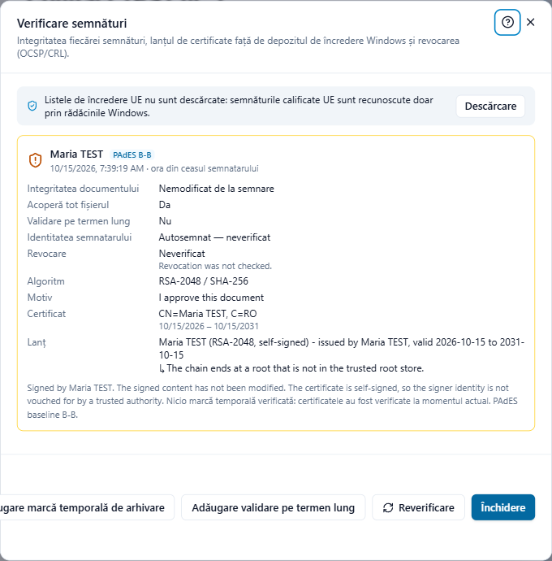

# Verificarea semnăturilor

Când deschideți un PDF semnat, Adika îi verifică semnăturile și arată rezultatul în dreapta jos a ferestrei, de exemplu **o semnătură intactă** cu verde sau **cu probleme** cu roșu. Faceți clic pe acest text sau pe **Semnare → Verificare** pentru detalii.

## Verde, portocaliu, roșu

Fiecare semnătură are o fișă cu chenar colorat:

- **Verde**: documentul nu s-a modificat de la semnare, iar certificatul semnatarului este de încredere (duce la o rădăcină de încredere din Windows sau la listele de încredere UE), fără avertismente.
- **Portocaliu**: documentul nu s-a modificat, dar Adika nu poate confirma cine a semnat: certificatul este autosemnat, lanțul este incomplet, certificatul nu este de încredere pe acest calculator, nu era valabil în momentul semnării sau există avertismente (citiți-le). Conținutul este intact; identitatea cere aprecierea dumneavoastră.
- **Roșu**: semnătura este invalidă (documentul a fost **modificat** după semnare) sau certificatul este **revocat**. Nu vă bazați pe acest document; cereți expeditorului o copie nouă.

Rândul de sub nume arată de unde provine ora semnării: **marcă temporală de încredere** (un server de marcare temporală a confirmat-o), **marcă temporală neverificată** sau **ora din ceasul semnatarului** (doar calculatorul semnatarului o afirmă).

## Rândurile fișei

- **Integritatea documentului**: **Nemodificat de la semnare** sau **MODIFICAT — semnătură invalidă**.
- **Acoperă tot fișierul**: **Da** când după această semnătură nu s-a mai adăugat nimic. Când s-a adăugat ceva, Adika verifică ce anume:
  - **Modificări permise după semnare:** urmat de **date de validare**, **alte semnături**, **completarea formularului** sau **comentarii**. Acestea sunt normale: alte persoane au semnat după dumneavoastră sau cineva a completat un formular pe care semnatarul a permis să fie completat.
  - **Nu — conținutul a fost modificat după această semnătură**, cu motivele (de exemplu o pagină sau textul ei a fost schimbat). Semnătura acoperă o versiune mai veche a documentului; ceea ce vedeți nu este ceea ce s-a semnat.
- **Certificat**: apare la semnăturile de certificare, cu ce permit acestea.
- **Validare pe termen lung**: dacă datele de validare sunt păstrate în fișier.
- **Calificat UE**: **Semnătură electronică calificată** (certificat calificat pe un dispozitiv calificat), **Semnătură avansată, certificat calificat** sau **Emitentul este un serviciu de încredere calificat**, confirmate de listele de încredere UE. „Declarat de certificat, neconfirmat” înseamnă că listele nu sunt descărcate.
- **Identitatea semnatarului**: **De încredere (lista de încredere UE)**, **De încredere (lanț până la o rădăcină Windows)**, **Autosemnat — neverificat**, **Lanț incomplet**, **Nu este de încredere pe acest computer** sau **Certificatul nu este valabil la momentul validării**.
- **Revocare**: **Nerevocat**, **REVOCAT**, **Necunoscut** sau **Neverificat**.
- **Algoritm**, **Motiv**, **Certificat** (titular și valabilitate) și **Lanț** (fiecare certificat până la rădăcină).

## Listele de încredere UE

Bara din partea de sus a ferestrei se referă la **listele de încredere UE**: listele oficiale ale furnizorilor de servicii de încredere calificate din fiecare stat UE. Cu ele, Adika recunoaște semnăturile calificate din toată UE, nu doar pe cele al căror certificat rădăcină se află în Windows.

- Faceți clic pe **Descărcare** prima dată (și pe butonul de actualizare din când în când). Adika descarcă listele de la Comisia Europeană, le verifică semnăturile și le păstrează pe acest calculator.
- Listele a căror semnătură nu se verifică nu sunt folosite și sunt numite în bară.

## Revocarea

Un certificat poate fi retras (revocat) înainte de expirare, de exemplu când un token este pierdut. Bifați **Verificare online a revocării (OCSP / CRL)** și faceți clic pe **Reverificare** pentru a-l întreba pe emitent. Fără internet, Adika folosește datele de validare păstrate în fișier, dacă există.

## Butoanele

- **Reverificare** rulează din nou verificările (după descărcarea listelor de încredere sau după bifarea verificării revocării).
- **Salvare raport** salvează un raport PDF cu ce s-a verificat, cu numele fișierului urmat de `-validation`. Util pentru arhivă sau pentru a-l trimite cuiva.
- **Adăugare validare pe termen lung** păstrează în fișier lanțurile de certificate și răspunsurile de revocare, astfel încât semnăturile să poată fi verificate fără internet și peste ani. Semnăturile rămân valide.
- **Adăugare marcă temporală de arhivare** adaugă date de validare și o marcă temporală peste întregul fișier (PAdES B-LTA). Repetați-o la câțiva ani pentru documentele care trebuie păstrate mult timp.

Ultimele două au nevoie de internet și modifică fișierul: salvați sau anulați mai întâi celelalte modificări.

## Mărcile temporale ale documentului

O fișă **Marcă temporală a documentului** nu este semnătura unei persoane: este o marcă temporală peste întregul fișier, de obicei o marcă temporală de arhivare. Arată autoritatea de marcare temporală în locul semnatarului.

Mai departe: [Probleme la semnare](signing-troubleshooting.md)
