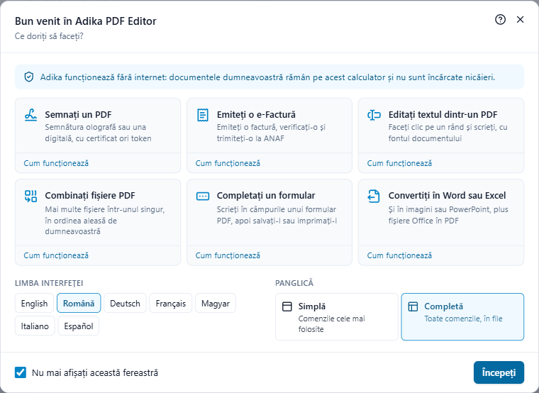
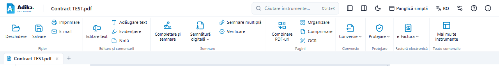

# Fereastra de bun venit și panglica

Această pagină descrie ce vedeți la prima pornire a Adika, cum treceți între panglica simplă și cea completă și unde se află instrumentele în fiecare filă a panglicii.

## Fereastra de bun venit

La prima pornire a programului Adika se deschide o fereastră de bun venit peste ecranul de start. Tot ce face Adika se petrece pe calculatorul dumneavoastră: funcționează fără internet, iar documentele nu sunt încărcate nicăieri.

La **Ce doriți să faceți?** puteți începe imediat una dintre cele mai obișnuite activități:

- **Semnați un PDF**: alegeți PDF-ul, apoi plasați semnătura olografă (Completare și semnare). Pentru o semnătură digitală cu certificat sau token, vedeți [Semnarea unui document](signing-sign.md).
- **Emiteți o e-Factură**: deschide editorul de facturi. Vedeți [Emiterea unei facturi](efactura-create.md).
- **Editați textul dintr-un PDF**: alegeți PDF-ul, apoi faceți clic pe orice rând de text și scrieți. Textul nou este scris cu fontul documentului.
- **Combinați fișiere PDF**: alegeți mai multe PDF-uri, așezați-le în ordinea dorită și faceți clic pe butonul **Combinare** de sub listă.
- **Completați un formular**: alegeți PDF-ul; câmpurile formularului se deschid în panoul din dreapta. Puteți scrie și direct în câmpurile de pe pagină.
- **Convertiți în Word sau Excel**: deschide fereastra Instrumente (PDF în Word, PDF în Excel, PDF în JPG, Word în PDF…).

**Cum funcționează**, sub fiecare activitate, deschide pagina potrivită din acest ghid. În aceeași fereastră puteți alege **limba interfeței** și **panglica** (simplă sau completă, vedeți mai jos).

Lăsați bifată opțiunea **Nu mai afișați această fereastră** și faceți clic pe **Începeți** pentru a o închide definitiv; debifați-o dacă doriți să o vedeți la fiecare pornire. O puteți redeschide oricând: **Ajutor** (F1) → **Ecran de bun venit** sau scrieți „bun venit” în **Căutare instrumente…** (Ctrl+K).

## Panglica simplă și panglica completă

Panglica este banda de comenzi din partea de sus a ferestrei. Are două forme:

- **Panglica simplă** arată pe un singur rând aproximativ douăzeci dintre cele mai folosite comenzi, grupate după activitate: **Fișier** (Deschidere, Salvare, Imprimare, E-mail), **Editare și comentarii** (Editare text, Adăugare text, Evidențiere, Notă), **Semnare** (Completare și semnare, Semnătură digitală, Semnare multiplă, Verificare), **Pagini** (Combinare PDF-uri, Organizare, Comprimare, OCR), **Conversie**, **Protejare** (parolă, anonimizare, informații ascunse) și **e-Factura** (factură nouă, deschiderea unei facturi, ANAF). Butoanele cu o săgeată mică deschid un meniu.
- **Panglica completă** are toate comenzile, în file (vedeți tabelul de mai jos).

Instalările noi pornesc cu panglica simplă; dacă ați mai folosit Adika, păstrați panglica completă. Pentru a schimba:

- faceți clic pe **Mai multe instrumente**, la capătul din dreapta al panglicii simple, pentru panglica completă;
- faceți clic pe **Panglică simplă** în fila **Vizualizare** a panglicii complete pentru a reveni;
- sau faceți clic pe butonul **Panglică simplă** din partea de sus a ferestrei: comută în ambele sensuri.

Adika ține minte alegerea dumneavoastră. **Căutare instrumente…** (Ctrl+K) găsește întotdeauna toate comenzile, și în panglica simplă: când o comandă există doar în panglica completă, Adika îi arată fila pentru o vreme și o execută; **Înapoi la panglica simplă** (în dreapta, lângă file) vă readuce. Bara de acces rapid funcționează în ambele panglici.

Când fereastra este prea îngustă pentru o filă, unele grupuri se strâng într-un singur buton cu numele grupului: faceți clic pe el pentru a vedea comenzile grupului.

## Panglica pe scurt

În panglica completă, comenzile sunt grupate în file, în partea de sus a ferestrei:

| Filă | Ce găsiți acolo |
| --- | --- |
| **Pornire** | Deschidere, Salvare, Imprimare, E-mail, Anulare / Refacere, selectarea textului, zoom, Căutare, Completare și semnare |
| **Vizualizare** | Aranjarea paginilor, rotirea afișării, modul de citire, citirea cu voce tare, panourile laterale (pagini, marcaje, atașamente, comentarii) |
| **Editare** | Editarea textului, adăugarea de text, imagini, legături, antete și subsoluri, forme desenate |
| **Comentariu** | Note, evidențiere, ștampile, desene, lista comentariilor |
| **Semnare** | Semnătura olografă (Completare și semnare), semnături digitale cu certificat, token, certificat Windows sau semnătură în cloud, **Semnare multiplă**, **Verificare** |
| **Organizare** | Pagini: inserare, ștergere, mutare, rotire, împărțire, combinarea fișierelor |
| **Formulare** | Câmpuri de formular, completare, detectarea câmpurilor |
| **Securitate** | Parole, permisiuni, anonimizare (înnegrire), eliminarea informațiilor ascunse, accesibilitate |
| **Conversie** | PDF în Word, Excel, imagini; PDF/A; OCR; comprimare; **Factură electronică**, **Factură electronică nouă**, **ANAF e-Factura** |

Nu știți unde se află o comandă? Faceți clic pe **Căutare instrumente…** în partea de sus a ferestrei (sau apăsați **Ctrl+K**) și scrieți ce doriți să faceți, de exemplu „factură” sau „semnare”.

Majoritatea butoanelor afișează o scurtă explicație când țineți mouse-ul deasupra lor. Apăsați **Alt** pentru a ajunge la panglică de la tastatură, apoi folosiți săgețile și Enter (în panglica simplă: Tab și Enter).

## Pașii următori

- [Primii pași](getting-started.md): deschiderea, salvarea, filele, tragerea și plasarea
- [Semnarea unui document](signing-sign.md)
- [Emiterea unei facturi](efactura-create.md)
